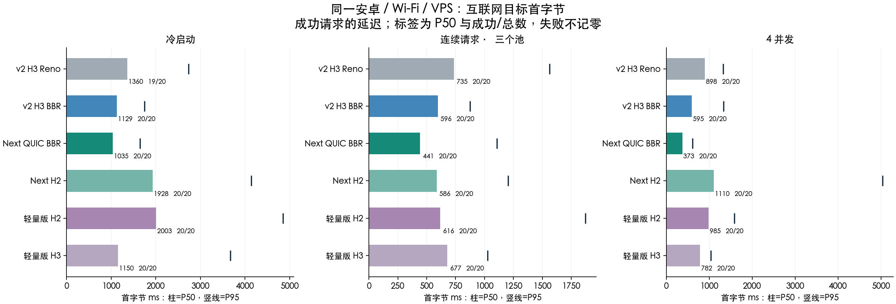
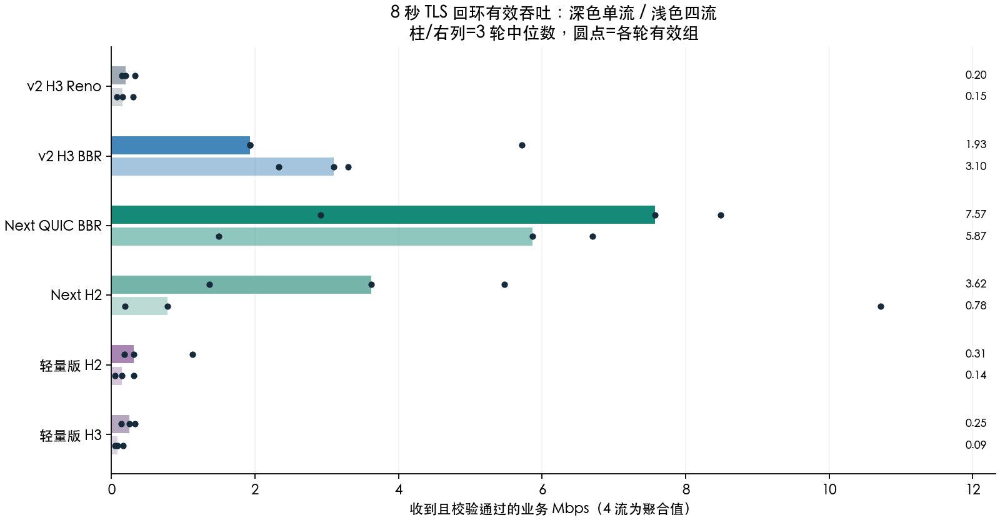

# FastCat Next 原型验收与对照报告

日期：2026-11-21。完整结果以本目录原始 JSONL、CSV 为准。

## 结论与验收边界

本轮交付了独立的 FCN/1 协议原型、Linux 服务端、安卓核心测试工具和规范；完成了 1002 次正式短请求、主对照 18 次 1 MiB 下载、另外 12 次 1 MiB 拥塞配置验证、6 次 10/100 MiB 传输、36 组单/四流吞吐、空闲恢复与 UDP 对照。**原型 TCP 功能验证通过，生产替换验收尚未通过，保持 v2 正式入口不变。**

判断依据：

- Next H2 与原生 QUIC 的正式短请求均为 167/167，半关闭、错误凭证拦截、网络代际重置、证书验证、取消隔离与空闲后新会话重建通过。
- Next 原生 QUIC 的 1 MiB 下载为 2/3：一次入口在 5 秒总截止前未完成，尚未从抓包定位原因；H2 为 3/3，但一次耗时 12.879 秒。失败和慢样本全部保留。
- Next 在本轮 4/8 并发的首字节表现较好；单池串行和连续请求 P95 没有全面优势。不能以“新格式”解释所有改善：v2 BBR 本身的吞吐也大幅提高。
- 原生 UDP 已连通，1100 B 上限与超限拒绝正常；同网出现明显丢包，尚不具备稳定实时业务的上线证据。
- 原型未接正式 App/面板/自动选路/ECH。原生 QUIC 使用可见实验 ALPN，**没有隐蔽性优于 v2 或避免 GFW 识别的验收结论**。

| 路径 | 正式短请求成功/总数 | 失败数 |
| --- | --- | --- |
| next/h2 | 167/167 | 0 |
| next/quic | 167/167 | 0 |
| v2-bbr/h3 | 167/167 | 0 |
| v2-reno/h3 | 165/167 | 2 |
| v3-light-fast/h2 | 167/167 | 0 |
| v3-light-fast/h3 | 160/167 | 7 |

本轮关键首字节对照（ms，P50 / P95；各组样本数见下文）：

| 场景 | Next 原生 QUIC BBR | v2 H3 BBR |
| --- | --- | --- |
| 互联网冷启动 | 1,035.0 / 1,647.1 | 1,128.6 / 1,745.2 |
| 互联网连续 | 441.2 / 1,107.9 | 596.0 / 873.2 |
| 互联网4并发 | 372.9 / 608.4 | 595.0 / 1,329.2 |
| 受控8并发 | 427.3 / 681.3 | 595.6 / 1,393.9 |
| 受控单池连续 | 661.2 / 1,633.5 | 794.0 / 1,350.4 |

原生 QUIC 8 秒有效吞吐中位数：Next 单流 7.6 / 四流聚合 5.9 Mbps；v2 BBR 为 1.9 / 3.1 Mbps。每组仅三轮，波动与完整下载结果必须一起看。

本轮交付是 FCN/1 独立原型：原生 QUIC/TLS 1.3 的独立 TCP 流与 UDP 数据报，加 HTTP/2/TLS 1.3 的 TCP 备用载体。采用 TLS exporter 绑定的账号 HMAC 授权，不叠加 Noise 和载荷二次加密。它不是自创密码算法，也不是浏览器 HTTP/3。

## 环境与方法

- 实机：安卓 TFY-AN00，序列号 A3GMVB2110006859，Android 12/API 31；同一 Wi-Fi。独立核心命令行程序，测试时 VPN 关闭；不是正式 App/TUN 的整链路性能。
- 服务端：zlhk.fastcat.ink / 191.223.214.8，同一生产共用 VPS 的独立测试端口。正式 443/18447 未变更；负载、无线信号与公网拥塞没有被隔离。
- Go 版本：安卓客户端 1.26.2；v2/轻量版服务器 1.27.3；Next 服务器 1.26.2。因此该对照是实现与配置的比较，不是仅改变线上消息格式的因果实验。
- 同一有效证书、严格域名验证；Next 与 v2 客户端 QUIC 接收窗口均为流 2/6 MiB、连接 3/15 MiB。全部未开启 TLS 0-RTT；Next 不周期保活。v2 服务端沿用库默认接收窗口，Next 服务端显式使用上述窗口，也属于实现配置差异。
- v2 Reno 和 BBR 使用同一 CatNode H3 handler 的实验包装，同一服务端程序，仅配置不同。双端 BBR 均采用 Mihomo 的同一实现，标准 profile，初始拥塞窗 32 包。第一轮端口为 Reno 19442 / BBR 19440；因此不能把首轮称为严格同端口的因果实验。
- Next H2 使用固定物理 TLS 的 http2.ClientConn，避免透明重连复用旧 exporter；原生 QUIC 使用 fcn-lab/1 实验 ALPN。最新轻量版为 v3-light-fast，未修改协议实现。
- 受控目标：服务器独立 HTTPS HEAD，固定 IP + zlhk.fastcat.ink 证书名。互联网目标 example.com:443，未固定其 CDN IP。
- 短请求交错轮换载体和版本顺序；吞吐按载体分块，块内轮换版本，未做完全随机顺序。普通请求外层 12 秒预算，入口自身可能有更短截止。冷启动含入口建立；连续 20 次分散到 3 个池；单池连续另测 20 次；4 并发 5 批、8 并发 3 批。prime 行保留，不算正式结果。
- 各载体 Dial 返回的完成阶段不同，尤其 Next 原生 QUIC 的目标状态延迟到 Read。应比较完整首字节，不能把不同协议的 entry_us 直接解释为同一工作量。
- P50 为成功样本中位数，P95 为成功样本近邻秩；失败单独计数，绝不记成零延迟。20 次的 P95 接近第二慢样本，不能推定长期稳定性。

## 受控目标首字节

表格单元格：成功/总数 · P50 / P95，单位 ms。

| 路径 | cold | warm | batch |
| --- | --- | --- | --- |
| v2 · H3 Reno | 19/20 · 1,128.6 / 2,808.6 | 20/20 · 708.2 / 1,842.6 | 20/20 · 925.8 / 6,021.5 |
| v2 · H3 BBR | 20/20 · 956.8 / 2,925.7 | 20/20 · 711.9 / 1,121.4 | 20/20 · 574.8 / 821.3 |
| Next · 原生 QUIC BBR | 20/20 · 1,143.4 / 1,375.4 | 20/20 · 552.3 / 1,260.4 | 20/20 · 405.6 / 1,197.0 |
| Next · H2 | 20/20 · 1,542.7 / 3,605.9 | 20/20 · 991.8 / 2,057.3 | 20/20 · 956.3 / 1,842.1 |
| 轻量版 · H2 | 20/20 · 2,184.8 / 4,922.8 | 20/20 · 638.4 / 1,726.2 | 20/20 · 827.0 / 2,123.0 |
| 轻量版 · H3 | 20/20 · 1,202.8 / 2,154.4 | 20/20 · 625.1 / 1,048.6 | 16/20 · 784.3 / 1,244.6 |

## 互联网目标首字节

| 路径 | cold | warm | batch |
| --- | --- | --- | --- |
| v2 · H3 Reno | 19/20 · 1,360.5 / 2,735.7 | 20/20 · 734.7 / 1,562.6 | 20/20 · 898.3 / 1,328.3 |
| v2 · H3 BBR | 20/20 · 1,128.6 / 1,745.2 | 20/20 · 596.0 / 873.2 | 20/20 · 595.0 / 1,329.2 |
| Next · 原生 QUIC BBR | 20/20 · 1,035.0 / 1,647.1 | 20/20 · 441.2 / 1,107.9 | 20/20 · 372.9 / 608.4 |
| Next · H2 | 20/20 · 1,927.8 / 4,140.6 | 20/20 · 586.0 / 1,204.8 | 20/20 · 1,110.3 / 5,039.8 |
| 轻量版 · H2 | 20/20 · 2,003.1 / 4,851.2 | 20/20 · 615.9 / 1,872.9 | 20/20 · 985.4 / 1,581.1 |
| 轻量版 · H3 | 20/20 · 1,149.8 / 3,672.3 | 20/20 · 677.2 / 1,026.5 | 20/20 · 782.1 / 1,036.0 |

## 单池连续与 8 并发

| 路径 | batch |
| --- | --- |
| v2 · H3 Reno | 20/20 · 635.1 / 1,207.0 |
| v2 · H3 BBR | 20/20 · 794.0 / 1,350.4 |
| Next · 原生 QUIC BBR | 20/20 · 661.2 / 1,633.5 |
| Next · H2 | 20/20 · 915.7 / 2,812.1 |
| 轻量版 · H2 | 20/20 · 979.1 / 1,993.8 |
| 轻量版 · H3 | 20/20 · 878.8 / 2,145.0 |

| 路径 | batch |
| --- | --- |
| v2 · H3 Reno | 24/24 · 1,251.1 / 1,583.1 |
| v2 · H3 BBR | 24/24 · 595.6 / 1,393.9 |
| Next · 原生 QUIC BBR | 24/24 · 427.3 / 681.3 |
| Next · H2 | 24/24 · 979.9 / 1,128.9 |
| 轻量版 · H2 | 24/24 · 1,024.5 / 1,304.6 |
| 轻量版 · H3 | 24/24 · 949.7 / 1,730.8 |

## 拥塞控制对照

ablation

| 路径 | 阶段 | 成功/总数 | P50 ms | P95 ms |
| --- | --- | --- | --- | --- |
| v2-bbr | batch | 12/12 | 518.3 | 821.6 |
| v2-bbr | cold | 11/12 | 1,532.8 | 3,639.0 |
| v2-bbr | warm | 12/12 | 564.2 | 1,085.7 |
| v2-reno | batch | 12/12 | 632.7 | 1,278.1 |
| v2-reno | cold | 12/12 | 1,552.3 | 9,370.4 |
| v2-reno | warm | 12/12 | 579.1 | 852.6 |

## 1 MiB 下载完整性

固定 Content-Length、32 KiB 周期数据与 SHA-256 校验，单次 30 秒预算。超时即失败，保留收到的部分字节，不用定时吞吐替代完整下载。

ablation-download

| 路径 | 轮 | 完整且校验通过 | 总时长 s | 收到字节 | 错误 |
| --- | --- | --- | --- | --- | --- |
| v2-reno/h3 | 1 | False | 30.0 | 557056 | deadline exceeded |
| v2-bbr/h3 | 1 | True | 1.8 | 1048576 |  |
| v2-bbr/h3 | 2 | True | 3.2 | 1048576 |  |
| v2-reno/h3 | 2 | False | 30.0 | 557056 | deadline exceeded |
| v2-reno/h3 | 3 | True | 21.7 | 1048576 |  |
| v2-bbr/h3 | 3 | True | 1.9 | 1048576 |  |

ablation-sameport-download

| 路径 | 轮 | 完整且校验通过 | 总时长 s | 收到字节 | 错误 |
| --- | --- | --- | --- | --- | --- |
| v2-reno/h3 | 1 | False | 30.0 | 442368 | deadline exceeded |
| v2-bbr/h3 | 1 | True | 4.1 | 1048576 |  |
| v2-bbr/h3 | 2 | True | 4.2 | 1048576 |  |
| v2-reno/h3 | 2 | False | 30.0 | 491520 | deadline exceeded |
| v2-reno/h3 | 3 | True | 20.8 | 1048576 |  |
| v2-bbr/h3 | 3 | True | 3.8 | 1048576 |  |

downloads

| 路径 | 轮 | 完整且校验通过 | 总时长 s | 收到字节 | 错误 |
| --- | --- | --- | --- | --- | --- |
| next/h2 | 1 | True | 2.1 | 1048576 |  |
| v3-light-fast/h2 | 1 | True | 3.6 | 1048576 |  |
| v2-reno/h3 | 1 | True | 28.2 | 1048576 |  |
| v2-bbr/h3 | 1 | True | 2.2 | 1048576 |  |
| v3-light-fast/h3 | 1 | False | 30.0 | 524288 | H3_REQUEST_CANCELLED (local) |
| next/quic | 1 | True | 2.1 | 1048576 |  |
| v2-bbr/h3 | 2 | True | 4.3 | 1048576 |  |
| v3-light-fast/h3 | 2 | False | 30.0 | 458752 | H3_REQUEST_CANCELLED (local) |
| v2-reno/h3 | 2 | False | 30.0 | 393216 | deadline exceeded |
| next/quic | 2 | False | 5.0 | 0 | entry: context deadline exceeded |
| next/h2 | 2 | True | 12.9 | 1048576 |  |
| v3-light-fast/h2 | 2 | True | 3.4 | 1048576 |  |
| next/quic | 3 | True | 5.0 | 1048576 |  |
| next/h2 | 3 | True | 4.1 | 1048576 |  |
| v3-light-fast/h2 | 3 | True | 3.1 | 1048576 |  |
| v3-light-fast/h3 | 3 | False | 30.0 | 507904 | H3_REQUEST_CANCELLED (local) |
| v2-reno/h3 | 3 | False | 30.0 | 425984 | deadline exceeded |
| v2-bbr/h3 | 3 | True | 3.9 | 1048576 |  |

## 8 秒回环有效吞吐

入口和目标 TLS 建立后计时，单流与 4 流分别 3 轮。只计收到且模式校验通过的业务字节；4 流值是聚合值，非每流速率。每组全部流无早期错误才作为有效组，失败组保留。单位 Mbps。

ablation-throughput

| 路径 | 并发流 | 有效组 | 中位数 | 各轮值 |
| --- | --- | --- | --- | --- |
| v2-bbr/h3 | 1 | 3/3 | 8.8 | 8.8, 4.0, 11.0 |
| v2-bbr/h3 | 4 | 3/3 | 7.1 | 7.1, 7.8, 1.9 |
| v2-reno/h3 | 1 | 3/3 | 0.4 | 0.2, 0.4, 0.4 |
| v2-reno/h3 | 4 | 3/3 | 0.2 | 0.3, 0.2, 0.2 |

throughput

| 路径 | 并发流 | 有效组 | 中位数 | 各轮值 |
| --- | --- | --- | --- | --- |
| next/h2 | 1 | 3/3 | 3.6 | 1.4, 3.6, 5.5 |
| next/h2 | 4 | 3/3 | 0.8 | 0.8, 0.2, 10.7 |
| next/quic | 1 | 3/3 | 7.6 | 7.6, 8.5, 2.9 |
| next/quic | 4 | 3/3 | 5.9 | 1.5, 6.7, 5.9 |
| v2-bbr/h3 | 1 | 3/3 | 1.9 | 1.9, 1.9, 5.7 |
| v2-bbr/h3 | 4 | 3/3 | 3.1 | 2.3, 3.1, 3.3 |
| v2-reno/h3 | 1 | 3/3 | 0.2 | 0.2, 0.1, 0.3 |
| v2-reno/h3 | 4 | 3/3 | 0.2 | 0.1, 0.3, 0.2 |
| v3-light-fast/h2 | 1 | 3/3 | 0.3 | 1.1, 0.3, 0.2 |
| v3-light-fast/h2 | 4 | 3/3 | 0.1 | 0.0, 0.1, 0.3 |
| v3-light-fast/h3 | 1 | 3/3 | 0.2 | 0.1, 0.2, 0.3 |
| v3-light-fast/h3 | 4 | 3/3 | 0.1 | 0.0, 0.2, 0.1 |

## 空闲后恢复

标称等待 70 秒；因各路径预热/恢复检查串行，使用每行 idle_us 的实际值。idle-resume 的 round=1 是首个新请求，round=2/3 是其后两次，不是三次独立空闲试验。轻量版保留原生命周期行为。

| 路径 | 阶段 | 实际 idle 秒 | 成功 | 首字节 ms / 错误 |
| --- | --- | --- | --- | --- |
| next/h2 | idle-resume #1 | 76.4 | True | 2,166.4 |
| next/h2 | idle-resume #2 | — | True | 663.6 |
| next/h2 | idle-resume #3 | — | True | 655.6 |
| v3-light-fast/h2 | idle-resume #1 | 78.4 | True | 414.7 |
| v3-light-fast/h2 | idle-resume #2 | — | True | 380.1 |
| v3-light-fast/h2 | idle-resume #3 | — | True | 389.0 |
| v2-reno/h3 | idle-resume #1 | 77.6 | True | 1,032.7 |
| v2-reno/h3 | idle-resume #2 | — | True | 679.6 |
| v2-reno/h3 | idle-resume #3 | — | True | 710.8 |
| v2-bbr/h3 | idle-resume #1 | 79.0 | True | 1,672.9 |
| v2-bbr/h3 | idle-resume #2 | — | True | 1,502.7 |
| v2-bbr/h3 | idle-resume #3 | — | True | 1,116.3 |
| v3-light-fast/h3 | idle-resume #1 | 82.4 | False | entry: use of closed network connection |
| v3-light-fast/h3 | idle-resume #2 | — | False | entry: use of closed network connection |
| v3-light-fast/h3 | idle-resume #3 | — | False | entry: use of closed network connection |
| next/quic | idle-resume #1 | 81.4 | True | 688.8 |
| next/quic | idle-resume #2 | — | True | 284.9 |
| next/quic | idle-resume #3 | — | True | 856.5 |

## 安卓协议功能与 UDP

| 载体 | 检查 | 结果 | 耗时 ms |
| --- | --- | --- | --- |
| quic | half-close-256KiB | 通过 | 1550 |
| quic | fresh-after-network-reset | 通过 | 1226 |
| quic | wrong-key-rejected | 通过 | 323 |
| h2 | half-close-256KiB | 通过 | 2255 |
| h2 | fresh-after-network-reset | 通过 | 4657 |
| h2 | wrong-key-rejected | 通过 | 499 |
| quic | udp1100-01 | 通过 | 105 |
| quic | udp1100-02 | 通过 | 102 |
| quic | udp1100-03 | 通过 | 131 |
| quic | udp1100-04 | read fcn-datagram: deadline exceeded | 2000 |
| quic | udp1100-05 | 通过 | 122 |
| quic | udp1100-06 | 通过 | 101 |
| quic | udp1100-07 | 通过 | 101 |
| quic | udp1100-08 | 通过 | 101 |
| quic | udp1100-09 | read fcn-datagram: deadline exceeded | 2000 |
| quic | udp1100-10 | read fcn-datagram: deadline exceeded | 2000 |
| quic | udp1100-11 | 通过 | 127 |
| quic | udp1100-12 | 通过 | 101 |
| quic | udp1100-13 | 通过 | 102 |
| quic | udp1100-14 | 通过 | 101 |
| quic | udp1100-15 | 通过 | 101 |
| quic | udp1100-16 | 通过 | 101 |
| quic | udp1100-17 | read fcn-datagram: deadline exceeded | 2001 |
| quic | udp1100-18 | read fcn-datagram: deadline exceeded | 2001 |
| quic | udp1100-19 | read fcn-datagram: deadline exceeded | 2000 |
| quic | udp1100-20 | 通过 | 129 |
| quic | udp-oversize-rejected | 通过 | 0 |

UDP 额外同网对照：直接 UDP 与 FCN QUIC 数据报，32/1100 字节各 30 次，交错发送，无隐式重传，1 秒接收预算。丢失方向、网络拥塞和策略尚未通过抓包完全定位；直接 UDP 本身与 QUIC 的传输开销/拥塞控制不同，不能只看它们的平均值推断协议缺陷。

| 路径 | 载荷 B | 送达/总数 | P50 ms | P95 ms |
| --- | --- | --- | --- | --- |
| direct-udp | 32 | 24/30 | 105.3 | 150.2 |
| direct-udp | 1100 | 19/30 | 105.6 | 143.8 |
| fcn-quic | 32 | 28/30 | 103.2 | 158.6 |
| fcn-quic | 1100 | 23/30 | 110.5 | 193.8 |

## 本地自检与修复

- 8 并发、每流 256 KiB 回环，内容逐字节检查，正确处理发送半关闭。
- 空闲连接关闭后新业务重新握手；显式网络代际 Reset 后新业务恢复；已有业务不重放。
- 错误密钥不得拨目标；exporter 跨连接证明、重复 nonce、篡改消息和畸形长度拒绝；私网/保留目标与超限 nonce 集合拒绝。
- UDP 1100 字节、零字节、超限拒绝；证书不信任必须失败；单个业务取消不影响其他流。
- 重复 race 测试发现 H2 清理回调可能在 handler 返回后仍访问响应对象。已改为等待已启动回调结束后返回，并重复 race 5 轮通过。正式 Next 数据使用修复后的服务器；initial pilot 单独保留，不算最终验收样本。
- FuzzHeader 5 秒覆盖畸形长度/消息解析；详细输出见 local/。本轮未做外部安全审计。

## 同端口追加验证

为排除首轮 19440/19442 端口不同这一因素，在全部主测试结束并清理后，重新使用 **同一 19442 入口**、同一服务端程序、同一证书/目标/账号。仅在双端 Reno 与 BBR 间切换，轮次顺序为 Reno→BBR、BBR→Reno、Reno→BBR，各下载 1 MiB。每次重启测试服务获得新连接，目标数据都校验长度与 SHA-256，30 秒截止。没有修改生产服务。

| 同端口模式 | 校验通过/总数 | 每轮时长 s | 失败收到字节 |
| --- | --- | --- | --- |
| v2-reno | 1/3 | 30.0, 30.0, 20.8 | 442368, 491520 |
| v2-bbr | 3/3 | 4.1, 4.2, 3.8 | 无 |

这组是在主测试之后的另一时间段，不能与前面的下载时长直接合并成同一次样本。它用于检查同端口下现象能否重现；不代表所有网络或所有 BBR 实现都得到同样收益。

## 如何解释收益和失败

1. **先修配置，再评估协议。** 原 v2 走库默认 Reno，与 Hysteria 2/TUIC 的 BBR 不在同一条件。首轮与同端口追加组是独立验证。新协议不能把换拥塞控制的收益都算到新消息格式上。
2. **Next 的结构收益在减少等待与独立流。** 原生 QUIC 完成 TLS 后即可将授权 OPEN 和首个业务数据连续排队，无需额外 Noise 授权往返或等待 HTTP CONNECT 成功后才开始业务握手。没有应用层二次多路复用与逐记录加密。这提供省去等待的机会；当前实现、窗口和 Go 版本也存在差异，不能把全部毫秒差视作格式本身的因果效果。
3. **并发收益更一致，串行仍有取舍。** 对每轮做配对、并发按批次聚合后，互联网 4 并发 5/5 批 Next 更快；其他冷启动/连续组的配对中位数差参考区间仍跨零。详见 paired-round-analysis.json，不能据一次 P50 就宣称全面领先。
4. **入口失败已定位到预算层，网络根因仍未知。** 原生 QUIC 下载失败行是约 5002 ms 的 entry 错误，尚未建立目标 TLS，没有收到部分文件。源码 acquire 对地址处理、建 socket 与 QUIC 建立设置 5 秒总预算，另外 QUIC 还有 5 秒无进展握手截止；两者语义不同。本次入口使用数值 IP，未经过入口 DNS，且目标 TLS 尚未开始；入口 DNS 可以排除。根据错误与代码，等待停在 QUIC 建立阶段，但没有该次逐包记录，不能确认具体是丢包、PTO、MTU 或握手处理延迟。没有通过延长超时、自动重试或删除样本把它变成“成功”。后续应拆分时序与 QUIC 丢包/PTO 记录，并验证业务提交前的 H2 选路与回退。
5. **空闲恢复是明确的功能改善。** Next 发现物理连接不再可用时，为新业务重新建连接、重新计算 exporter 绑定证明；轻量版继续复用已关闭会话的行为在本轮重现。已有业务没有自动重放。
6. **UDP 是连通性验证，不是无损承诺。** 首轮 17/20 个 1100 B 报文收到回显；追加矩阵给出直接 UDP 与隧道的各 30 次结果。它们没有应用层重传，仍需多网络、长时与方向抓包才能定位丢失；目前不建议把本轮结果当作语音/游戏稳定性保证。
7. **资源字段只用于诊断。** 吞吐行的 heap、分配量和 goroutines 属于测试进程，不是每账号成本；服务端快照承受不同数量的载体与请求，也不能据此下耗电或多用户容量结论。

## 后续交付顺序

- 在原型增加入口分阶段与 QUIC 丢包/PTO 诊断，复现入口超时；保留原始失败，验证新业务选路/回退与证书、认证失败的停止条件。
- 原生 QUIC 与真实 HTTP/3 载体并列验证，测量 HTTP 层开销和真实握手行为；复用 v2 的入口加密 DNS/ECH，但必须对新载体重新验收，不继承旧实验结论。
- 完成账号动态撤销、每账号限额与计量接口、正式 App/TUN 接入，再做锁屏、多网络、多前置与面板灰度/回滚。达到门槛后才替换正式入口。

上轮七协议报告用于提出候选机制；本轮只同网重测 v2 两种拥塞配置、最新轻量版与 Next，不把不同时间的 Hysteria 2/TUIC 等结果拼成同一张速度排行。上轮报告位于 ../../fastcat-v3/seven-way-2026-11-21/REPORT.md。

## 10 MiB / 100 MiB 完整传输门槛

每路径、每文件大小各一次，不重试、不补成成功样本；10 MiB 总预算 90 秒，100 MiB 240 秒。扩容的是目标文件大小和测试工具截止，没有修改协议实现。该阶段晚于主对照，不能与之前 1 MiB 时长合并统计。原 Reno 与轻量版 H3 在 1 MiB 阶段已暴露持续失败，因此只对 Next 两种载体和 v2 BBR 做大文件门槛。

| 路径 | 目标 MiB | 完整且校验通过 | 收到 MiB | 时长 s | 预算 s | 错误 |
| --- | --- | --- | --- | --- | --- | --- |
| next/h2 | 10 | False | 2.5 | 90.0 | 90 | http2: response body closed |
| v2-bbr/h3 | 10 | True | 10.0 | 12.3 | 90 |  |
| next/quic | 10 | True | 10.0 | 7.0 | 90 |  |
| next/h2 | 100 | True | 100.0 | 87.5 | 240 |  |
| v2-bbr/h3 | 100 | True | 100.0 | 24.2 | 240 |  |
| next/quic | 100 | True | 100.0 | 23.8 | 240 |  |

Next 原生 QUIC 的 10/100 MiB 均通过；Next H2 的 10 MiB 在 90 秒只收到 2.5 MiB，100 MiB 后续却在 87.462 秒通过。两条结果全部保留，不能用较晚一次成功证明较早问题已解决。100 MiB 单向下载中 Next QUIC 23.785 秒、v2 BBR 24.171 秒，差异很小，且每组只有一次。8 秒双向回环与长时间单向下载不是同一负载，不能把短窗口吞吐倍数推广为长期带宽能力。

## 尚未验收的生产功能

本轮强制指定路径，未验收自动选路、交互/批量连接分组、正式 App/TUN、iOS、蜂窝与 Wi-Fi 切换、多前置、锁屏耗电、ECH、真实 HTTPS 站点共用、面板动态账号撤销/套餐计量/订阅灰度。H2 流截止采用取消整条请求，尚无独立可恢复的读写超时。原型 UDP 载荷上限 1100 B，没有分片，不是完整任意 UDP VPN。

TLS 与 QUIC 参数由现有实现生成，实验 ALPN、连接行为和包长仍可见。没有受控 GFW 识别率测试，不能据此承诺比 v2 更隐蔽或不会被封锁。

## 文件说明

- requests.csv / latency-summary.csv：逐请求与统计；JSONL 保留失败、prime 与原始计时。
- downloads.csv / throughput.csv：完整下载与定时有效吞吐原值。
- functional-android.jsonl / udp-matrix.jsonl：真机功能与数据报原值。
- metadata.json / network-summary.json / SHA256SUMS：构建与校验信息。
- SPEC-0.1.md 位于上级目录，sources/ 为本轮源码快照，均不含账号密钥。

## 图表

## 环境恢复

已停止并删除本轮临时入口、服务器运行凭证和设备测试配置；安卓 VPN 已恢复，USB 常亮设置恢复为 0。正式 443 与 18447 仍在监听，未发布或替换正式 App。详见 cleanup.json。
