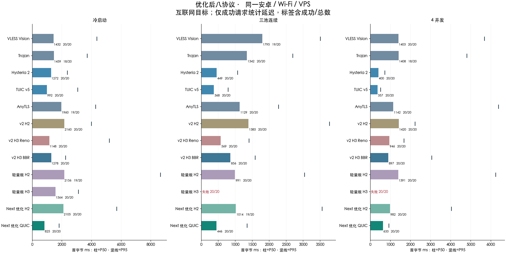
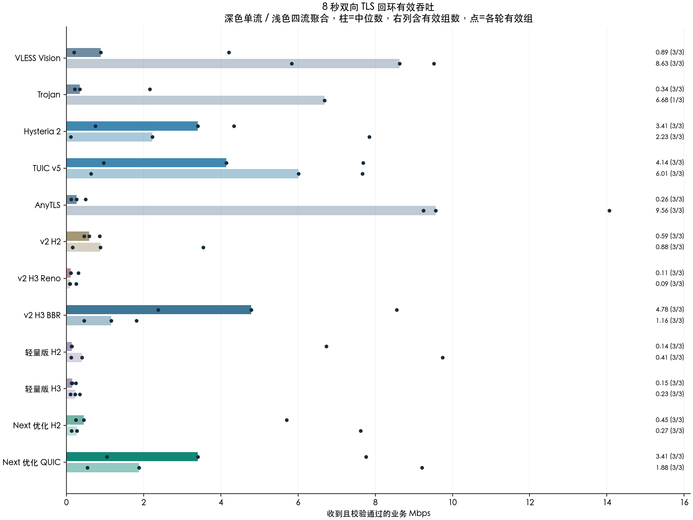

# 优化后八协议安卓对照报告

日期：2026-11-21。新协议为 FastCat Next / FCN/1 实现优化 0.2。本轮共 8 类协议、12 条具体配置路径；v2 分别保留 H2、原 H3 Reno 与 H3 BBR。

## 结论

已完成修复自检与本轮全部对照。**QUIC 的额外提前截止及建立连接时的锁等待已修复；H2 已增加坏入口连接退役保护，但高重传 TCP 链路造成的当前业务失速不能由此消除。小 TCP 报文未设为默认。**

主比较保留所有失败，不补样本、不自动重放业务。本轮仍是独立安卓核心与临时服务端测试，没有替换正式 App 或正式节点，也没有隐蔽性验收结论。

互联网目标核心结果：首字节为 P50/P95 ms（成功/总数），单流吞吐为 3 轮有效组中位数 Mbps；完整表与失败阶段见后文。

| 路径 | 全部短请求 | 冷启动 | 连续请求 | 4 并发 | 单流 Mbps | 1 MiB完整 |
| --- | --- | --- | --- | --- | --- | --- |
| VLESS Vision | 163/167 | 1,431.7/4,354.4 (20/20) | 1,794.5/3,505.1 (19/20) | 1,403.5/5,676.8 (20/20) | 0.9 | 3/3 |
| Trojan | 161/167 | 1,458.7/3,699.0 (18/20) | 1,342.1/2,690.2 (20/20) | 1,407.9/4,808.7 (18/20) | 0.3 | 2/3 |
| Hysteria 2 | 167/167 | 1,271.6/2,363.7 (20/20) | 449.5/1,065.4 (20/20) | 400.4/722.1 (20/20) | 3.4 | 3/3 |
| TUIC v5 | 167/167 | 991.5/3,066.6 (20/20) | 367.8/788.1 (20/20) | 356.6/505.8 (20/20) | 4.1 | 3/3 |
| AnyTLS | 161/167 | 1,960.4/4,273.6 (19/20) | 1,129.1/2,272.9 (20/20) | 1,142.1/6,377.9 (20/20) | 0.3 | 3/3 |
| v2 H2 | 166/167 | 2,160.4/3,990.4 (20/20) | 1,385.4/3,773.3 (20/20) | 1,419.6/2,219.7 (20/20) | 0.6 | 3/3 |
| v2 H3 Reno | 167/167 | 1,147.7/5,197.1 (20/20) | 569.3/1,404.0 (20/20) | 945.6/1,671.3 (20/20) | 0.1 | 1/3 |
| v2 H3 BBR | 166/167 | 1,278.2/2,248.7 (20/20) | 856.3/1,583.7 (20/20) | 896.8/3,054.4 (20/20) | 4.8 | 3/3 |
| 轻量版 H2 | 165/167 | 2,156.3/8,649.6 (19/20) | 990.7/3,039.7 (20/20) | 1,390.5/6,238.7 (20/20) | 0.1 | 3/3 |
| 轻量版 H3 | 76/167 | 1,564.1/3,112.5 (20/20) | —/— (0/20) | —/— (0/20) | 0.1 | 1/3 |
| Next 优化 H2 | 165/167 | 2,104.6/5,693.4 (20/20) | 1,014.5/3,553.8 (19/20) | 982.2/4,033.2 (20/20) | 0.5 | 3/3 |
| Next 优化 QUIC | 167/167 | 824.6/1,810.0 (20/20) | 445.7/1,345.8 (20/20) | 633.4/921.0 (20/20) | 3.4 | 3/3 |

在该组全部成功的配置中，按 P50 观察到的前三项如下。它不考虑所有取舍，也不是跨网络总排名；必须同时看 P95 和失败情况。

| 负载 | 本轮 P50 前三 |
| --- | --- |
| 冷启动 | Next 优化 QUIC 824.6 ms, TUIC v5 991.5 ms, v2 H3 Reno 1,147.7 ms |
| 连续请求 | TUIC v5 367.8 ms, Next 优化 QUIC 445.7 ms, Hysteria 2 449.5 ms |
| 4 并发 | TUIC v5 356.6 ms, Hysteria 2 400.4 ms, Next 优化 QUIC 633.4 ms |

新协议 QUIC 正式短请求 167/167；H2 为 165/167。数值只覆盖本次网络与负载，不将修复后的某次成功解释为既有网络问题已经消失。

大文件未通过项（若表为空表示本轮尝试均完成；每项只有一次，不代表长期可靠性）：

| 路径 | 文件组 | 时长 s | 收到 MiB | 错误 |
| --- | --- | --- | --- | --- |
| VLESS Vision | downloads100m-reference | 240.0 | 80.0 | read tcp 192.168.31.15:54528->191.223.214.8:19446: i/o timeout |
| Trojan | downloads10m | 90.0 | 1.6 | read tcp 192.168.31.15:37858->191.223.214.8:19448: i/o timeout |
| Hysteria 2 | downloads10m | 90.0 | 9.9 | deadline exceeded |
| TUIC v5 | post-reference100 | 240.0 | 15.3 | deadline exceeded |
| v2 H2 | downloads10m | 90.0 | 1.8 | read pipe: i/o timeout |
| v2 H3 Reno | downloads10m | 90.0 | 1.5 | deadline exceeded |
| v2 H3 BBR | downloads100m | 240.0 | 12.6 | deadline exceeded |
| 轻量版 H3 | downloads10m | 90.0 | 1.3 | H3_REQUEST_CANCELLED (local) |
| Next 优化 H2 | downloads10m | 90.0 | 2.4 | http2: response body closed |
| Next 优化 H2 | downloads100m | 240.0 | 9.5 | http2: response body closed |
| Next 优化 QUIC | downloads100m | 240.0 | 11.4 | deadline exceeded |

追加的紧邻 100 MiB 复核（各一次，原失败保留）：

| 路径 | 完整且校验 | 时长 s | 收到 MiB | 错误 |
| --- | --- | --- | --- | --- |
| Next QUIC 追加复核 | True | 46.0 | 100.0 |  |
| TUIC v5 | False | 240.0 | 15.3 | deadline exceeded |

TUIC 的晚期参考与追加复核帮助判断差异，但仍不是同时测量。不能将所有长传输超时归因于新协议消息格式，也不能直接断言只是网络普遍慢；共享 QUIC 实现、窗口/拥塞参数与连接/路径状态都需要后续逐项隔离。当前证据不足以发布新协议作为默认替代。

## 本轮修复及范围

1. QUIC 默认总入口预算由额外的 5 秒上限调整为 10 秒，与库最大握手限制对齐，仍受调用方更短截止和 5 秒无进展截止约束。受控测试持续投递握手报文：旧预算 5 秒失败，新预算约 5.21 秒完成。此证据复现实现弱点，不宣称已还原首轮那个公网失败的全部底层原因。
2. 连接建立移出全局锁；并发等待、Close 与网络 Reset 可及时取消，旧代际不会回填连接池。
3. H2 通过实际 TCP 与读写采样定位到高重传和下行背压，未发现接收窗口耗尽证据。读阻塞时合并检查入口 PING，只有入口也超时才为新业务退役旧连接；健康入口上的慢目标不误替换，已有业务不重放。此保护避免后续业务持续使用坏连接，不能修复已经在高丢包 TCP 链路上传输的文件。
4. 小 TCP 报文试验未成为默认：TCP_MAXSEG=1200 的 10 MiB 仅 2/3 完成，系统默认 1/3，仍有失速且样本不足。全组正式测试沿用系统默认 MSS，未改变 QUIC 初始包长。详见 OPTIMIZATION-0.2.md 与原始 mss-* 数据。

## 方法与可比性

- 同一安卓 TFY-AN00，Android 12/API 31，MT6833V/PNZA，同一 Wi-Fi；独立核心命令行程序，测试时 VPN 关闭。不是正式 App/TUN 或 iOS 的端到端测试。
- 同一香港 VPS 191.223.214.8，1 个在线 CPU、Linux 6.12.117，生产共用主机的独立入口；没有隔离其他用户流量。未修改正式 443/18447。
- 安卓 TCP 内核算法实测 BIC，服务端 TCP 为 BBR；QUIC 使用各实现自己的控制器。安卓客户端 Go 1.26.2，各服务端 Go 1.27.3。Next、v2、轻量版使用同一固定版本 metacubex/quic-go；原生协议使用 CatNode 当前 Xray 内核，其 QUIC 实现及参数不完全相同。
- 各路径使用同一有效证书域名 zlhk.fastcat.ink，严格验证证书，没有开启 TLS 0-RTT。协议路径与配置见下表；这比较的是实际实现及组合，不能把全部差值归因于线上消息格式。
- 主实验关闭诊断追踪；诊断/MSS 实验属于较早的独立阶段，不与主实验合并排名。
- 受控目标为同 VPS 独立 HTTPS，固定 IP、固定证书名、HEAD 200。Xray 嗅探可能将数值 IP 重新解释成 TLS 主机名，因此不能宣称所有实现都完全没有目标 DNS 工作。互联网目标为 example.com:443，未固定 CDN IP。
- 冷启动各 20 次；三池连续各 20 次；4 并发 5 批；单池连续另测 20 次；8 并发 3 批。短请求轮换载体/版本顺序，普通请求外层 12 秒，各实现仍有自身更短内部截止。预热单独保留，不计正式成功率。
- 首字节从本地开始到目标响应首字节，冷启动包含 factory/握手/认证。不同 Dial 返回语义不同，Next QUIC 不等待目标状态就允许排队业务数据；不应跨协议比较 entry_us 或将各阶段中位数相加。
- P50 是成功样本中位数，P95/P99 采用近邻秩；失败不记成零延迟。20 次样本的 P95 接近第二慢值，小样本和连续网络事件不能当作长期独立成功概率。
- 1 MiB 每路径 3 次，30 秒截止；10 MiB 每路径 1 次，90 秒截止；100 MiB 对 Next 两载体和 v2 BBR 各 1 次，240 秒截止。全部校验长度及 SHA-256，部分接收保留，不重试补样本。
- 主实验中长传输出现超时后，较晚追加 TUIC 与 VLESS Vision 各一次 100 MiB 参考（同样 240 秒）。它们单独标为 downloads100m-reference，不与早先样本合并统计，也不能消除测试时间差的影响。随后再追加一组紧邻的 Next QUIC/TUIC 100 MiB，单列为 post-reference100，避免用复测覆盖首次失败。
- 吞吐为入口及目标 TLS 建立后的 8 秒双向 TLS 回环，单流/四流各 3 轮，只计收到且验证通过的业务载荷。四流是聚合值；载体分块、块内轮换版本，并非完全随机顺序。不能等同单向长下载或链路带宽上限。

| 路径 | 实际组合 |
| --- | --- |
| VLESS Vision | VLESS + TCP + TLS + xtls-rprx-vision，无 REALITY、WS、gRPC、额外 VLESS 加密或多路复用 |
| Trojan | 原生 Trojan + TCP + TLS；即使 TLS ALPN 为 h2，载荷也不是 HTTP/2 隧道 |
| Hysteria 2 | QUIC + TLS 1.3 + BBR，无强制带宽/Brutal、obfs、端口跳跃 |
| TUIC v5 | TUIC v5 + QUIC + TLS 1.3 + BBR，0-RTT/FastOpen 关闭，默认心跳 |
| AnyTLS | TLS + 原生会话复用 + 默认填充；并发可能创建多条 TCP 会话 |
| v2 H2 | HTTP/2 + TCP + TLS 1.3 + 账号令牌 |
| v2 H3 Reno / BBR | HTTP/3 + QUIC + TLS 1.3 + 账号令牌；Reno 为库默认，BBR 为双端显式配置 |
| 轻量版 H2/H3 | 最新 v3-light-fast，TLS + Noise 授权 + 独立 HTTP 流，保留原实现与生命周期 |
| Next H2/QUIC | TLS 1.3 + exporter 绑定 OPEN 授权；原生 QUIC 独立流/数据报或真实 H2 POST；无 Noise 与载荷二次加密，QUIC 使用 BBR |

## 正式短请求总数

累计 2004 次正式请求。下表合并不同负载仅用于核对总数，不是某个单一业务的长期成功率。

| 路径 | 正式成功/总数 | 失败 |
| --- | --- | --- |
| VLESS Vision | 163/167 | 4 |
| Trojan | 161/167 | 6 |
| Hysteria 2 | 167/167 | 0 |
| TUIC v5 | 167/167 | 0 |
| AnyTLS | 161/167 | 6 |
| v2 H2 | 166/167 | 1 |
| v2 H3 Reno | 167/167 | 0 |
| v2 H3 BBR | 166/167 | 1 |
| 轻量版 H2 | 165/167 | 2 |
| 轻量版 H3 | 76/167 | 91 |
| Next 优化 H2 | 165/167 | 2 |
| Next 优化 QUIC | 167/167 | 0 |

## 受控目标首字节

单元格：成功/总数 · P50 / P95，单位 ms。cold=冷启动，warm=三池连续，batch=4 并发。

| 路径 | cold | warm | batch |
| --- | --- | --- | --- |
| VLESS Vision | 20/20 · 2,080.4 / 4,042.9 | 19/20 · 1,127.0 / 4,490.1 | 20/20 · 1,096.0 / 2,292.9 |
| Trojan | 19/20 · 1,129.1 / 3,684.6 | 20/20 · 1,565.1 / 3,206.6 | 20/20 · 1,354.6 / 3,001.9 |
| Hysteria 2 | 20/20 · 1,254.5 / 2,988.9 | 20/20 · 541.5 / 1,413.5 | 20/20 · 513.7 / 1,028.6 |
| TUIC v5 | 20/20 · 1,199.2 / 3,160.0 | 20/20 · 454.4 / 1,269.0 | 20/20 · 524.6 / 735.1 |
| AnyTLS | 20/20 · 1,694.0 / 5,327.5 | 19/20 · 994.5 / 5,056.4 | 19/20 · 1,629.1 / 9,547.6 |
| v2 H2 | 19/20 · 1,817.7 / 6,269.8 | 20/20 · 1,598.2 / 5,160.8 | 20/20 · 2,070.0 / 3,180.5 |
| v2 H3 Reno | 20/20 · 1,376.6 / 3,123.0 | 20/20 · 617.0 / 2,519.3 | 20/20 · 963.4 / 1,278.2 |
| v2 H3 BBR | 20/20 · 1,320.2 / 2,131.0 | 20/20 · 858.8 / 1,886.5 | 20/20 · 1,008.0 / 2,378.0 |
| 轻量版 H2 | 20/20 · 2,074.9 / 5,204.5 | 20/20 · 1,029.1 / 3,591.3 | 20/20 · 1,068.3 / 6,178.3 |
| 轻量版 H3 | 20/20 · 1,424.3 / 2,337.1 | 0/20 · — / — | 0/20 · — / — |
| Next 优化 H2 | 20/20 · 1,489.9 / 4,450.1 | 19/20 · 988.1 / 3,380.7 | 20/20 · 1,334.3 / 1,871.8 |
| Next 优化 QUIC | 20/20 · 1,117.1 / 2,767.2 | 20/20 · 435.8 / 1,134.1 | 20/20 · 598.5 / 1,009.2 |

## 互联网目标首字节

| 路径 | cold | warm | batch |
| --- | --- | --- | --- |
| VLESS Vision | 20/20 · 1,431.7 / 4,354.4 | 19/20 · 1,794.5 / 3,505.1 | 20/20 · 1,403.5 / 5,676.8 |
| Trojan | 18/20 · 1,458.7 / 3,699.0 | 20/20 · 1,342.1 / 2,690.2 | 18/20 · 1,407.9 / 4,808.7 |
| Hysteria 2 | 20/20 · 1,271.6 / 2,363.7 | 20/20 · 449.5 / 1,065.4 | 20/20 · 400.4 / 722.1 |
| TUIC v5 | 20/20 · 991.5 / 3,066.6 | 20/20 · 367.8 / 788.1 | 20/20 · 356.6 / 505.8 |
| AnyTLS | 19/20 · 1,960.4 / 4,273.6 | 20/20 · 1,129.1 / 2,272.9 | 20/20 · 1,142.1 / 6,377.9 |
| v2 H2 | 20/20 · 2,160.4 / 3,990.4 | 20/20 · 1,385.4 / 3,773.3 | 20/20 · 1,419.6 / 2,219.7 |
| v2 H3 Reno | 20/20 · 1,147.7 / 5,197.1 | 20/20 · 569.3 / 1,404.0 | 20/20 · 945.6 / 1,671.3 |
| v2 H3 BBR | 20/20 · 1,278.2 / 2,248.7 | 20/20 · 856.3 / 1,583.7 | 20/20 · 896.8 / 3,054.4 |
| 轻量版 H2 | 19/20 · 2,156.3 / 8,649.6 | 20/20 · 990.7 / 3,039.7 | 20/20 · 1,390.5 / 6,238.7 |
| 轻量版 H3 | 20/20 · 1,564.1 / 3,112.5 | 0/20 · — / — | 0/20 · — / — |
| Next 优化 H2 | 20/20 · 2,104.6 / 5,693.4 | 19/20 · 1,014.5 / 3,553.8 | 20/20 · 982.2 / 4,033.2 |
| Next 优化 QUIC | 20/20 · 824.6 / 1,810.0 | 20/20 · 445.7 / 1,345.8 | 20/20 · 633.4 / 921.0 |

## 单池连续

| 路径 | batch |
| --- | --- |
| VLESS Vision | 20/20 · 1,369.5 / 3,890.6 |
| Trojan | 19/20 · 1,363.9 / 3,885.5 |
| Hysteria 2 | 20/20 · 641.2 / 1,055.4 |
| TUIC v5 | 20/20 · 608.5 / 1,028.3 |
| AnyTLS | 20/20 · 528.0 / 1,925.8 |
| v2 H2 | 20/20 · 701.0 / 1,368.4 |
| v2 H3 Reno | 20/20 · 727.6 / 923.0 |
| v2 H3 BBR | 20/20 · 486.1 / 715.2 |
| 轻量版 H2 | 19/20 · 1,241.3 / 3,583.5 |
| 轻量版 H3 | 20/20 · 1,162.9 / 2,717.6 |
| Next 优化 H2 | 20/20 · 887.3 / 1,805.9 |
| Next 优化 QUIC | 20/20 · 504.0 / 762.2 |

## 8 并发

| 路径 | batch |
| --- | --- |
| VLESS Vision | 22/24 · 1,347.2 / 3,883.6 |
| Trojan | 24/24 · 1,904.6 / 4,402.3 |
| Hysteria 2 | 24/24 · 525.5 / 1,399.9 |
| TUIC v5 | 24/24 · 453.1 / 1,506.2 |
| AnyTLS | 21/24 · 742.8 / 2,331.0 |
| v2 H2 | 24/24 · 1,002.0 / 1,219.3 |
| v2 H3 Reno | 24/24 · 1,120.8 / 1,517.2 |
| v2 H3 BBR | 24/24 · 625.4 / 1,696.6 |
| 轻量版 H2 | 24/24 · 1,150.5 / 1,416.6 |
| 轻量版 H3 | 16/24 · 1,043.2 / 1,882.0 |
| Next 优化 H2 | 24/24 · 1,601.1 / 2,975.3 |
| Next 优化 QUIC | 24/24 · 526.6 / 950.0 |

## 完整下载

### downloads1m

| 路径 | 轮 | 完整+校验 | 总时长 s | 收到 MiB | 错误 |
| --- | --- | --- | --- | --- | --- |
| Next 优化 H2 | 1 | True | 13.7 | 1.0 |  |
| v2 H2 | 1 | True | 2.9 | 1.0 |  |
| 轻量版 H2 | 1 | True | 4.9 | 1.0 |  |
| v2 H3 Reno | 1 | True | 26.5 | 1.0 |  |
| v2 H3 BBR | 1 | True | 4.7 | 1.0 |  |
| 轻量版 H3 | 1 | True | 28.2 | 1.0 |  |
| VLESS Vision | 1 | True | 2.0 | 1.0 |  |
| Trojan | 1 | False | 30.0 | 0.8 | read tcp 192.168.31.15:37544->191.223.214.8:19448: i/o timeout |
| AnyTLS | 1 | True | 14.4 | 1.0 |  |
| Next 优化 QUIC | 1 | True | 5.3 | 1.0 |  |
| Hysteria 2 | 1 | True | 5.4 | 1.0 |  |
| TUIC v5 | 1 | True | 5.5 | 1.0 |  |
| v2 H3 Reno | 2 | False | 30.0 | 0.4 | deadline exceeded |
| v2 H3 BBR | 2 | True | 5.3 | 1.0 |  |
| 轻量版 H3 | 2 | False | 30.0 | 0.4 | H3_REQUEST_CANCELLED (local) |
| VLESS Vision | 2 | True | 27.5 | 1.0 |  |
| Trojan | 2 | True | 2.7 | 1.0 |  |
| AnyTLS | 2 | True | 28.8 | 1.0 |  |
| Hysteria 2 | 2 | True | 5.6 | 1.0 |  |
| TUIC v5 | 2 | True | 3.5 | 1.0 |  |
| Next 优化 QUIC | 2 | True | 4.0 | 1.0 |  |
| v2 H2 | 2 | True | 6.9 | 1.0 |  |
| 轻量版 H2 | 2 | True | 2.8 | 1.0 |  |
| Next 优化 H2 | 2 | True | 5.4 | 1.0 |  |
| VLESS Vision | 3 | True | 2.0 | 1.0 |  |
| Trojan | 3 | True | 4.9 | 1.0 |  |
| AnyTLS | 3 | True | 8.6 | 1.0 |  |
| Hysteria 2 | 3 | True | 2.8 | 1.0 |  |
| TUIC v5 | 3 | True | 5.3 | 1.0 |  |
| Next 优化 QUIC | 3 | True | 2.1 | 1.0 |  |
| 轻量版 H2 | 3 | True | 12.7 | 1.0 |  |
| Next 优化 H2 | 3 | True | 3.6 | 1.0 |  |
| v2 H2 | 3 | True | 6.5 | 1.0 |  |
| v2 H3 BBR | 3 | True | 8.2 | 1.0 |  |
| 轻量版 H3 | 3 | False | 30.0 | 0.5 | H3_REQUEST_CANCELLED (local) |
| v2 H3 Reno | 3 | False | 30.0 | 0.4 | H3 error (0x0) (local) |

### downloads10m

| 路径 | 轮 | 完整+校验 | 总时长 s | 收到 MiB | 错误 |
| --- | --- | --- | --- | --- | --- |
| Next 优化 H2 | 1 | False | 90.0 | 2.4 | http2: response body closed |
| v2 H2 | 1 | False | 90.0 | 1.8 | read pipe: i/o timeout |
| 轻量版 H2 | 1 | True | 14.4 | 10.0 |  |
| v2 H3 Reno | 1 | False | 90.0 | 1.5 | deadline exceeded |
| v2 H3 BBR | 1 | True | 13.2 | 10.0 |  |
| 轻量版 H3 | 1 | False | 90.0 | 1.3 | H3_REQUEST_CANCELLED (local) |
| VLESS Vision | 1 | True | 6.8 | 10.0 |  |
| Trojan | 1 | False | 90.0 | 1.6 | read tcp 192.168.31.15:37858->191.223.214.8:19448: i/o timeout |
| AnyTLS | 1 | True | 7.6 | 10.0 |  |
| Next 优化 QUIC | 1 | True | 15.5 | 10.0 |  |
| Hysteria 2 | 1 | False | 90.0 | 9.9 | deadline exceeded |
| TUIC v5 | 1 | True | 18.2 | 10.0 |  |

### downloads100m

| 路径 | 轮 | 完整+校验 | 总时长 s | 收到 MiB | 错误 |
| --- | --- | --- | --- | --- | --- |
| Next 优化 H2 | 1 | False | 240.0 | 9.5 | http2: response body closed |
| v2 H3 BBR | 1 | False | 240.0 | 12.6 | deadline exceeded |
| Next 优化 QUIC | 1 | False | 240.0 | 11.4 | deadline exceeded |

### downloads100m-reference

| 路径 | 轮 | 完整+校验 | 总时长 s | 收到 MiB | 错误 |
| --- | --- | --- | --- | --- | --- |
| VLESS Vision | 1 | False | 240.0 | 80.0 | read tcp 192.168.31.15:54528->191.223.214.8:19446: i/o timeout |
| TUIC v5 | 1 | True | 26.3 | 100.0 |  |

### post-reference100

| 路径 | 轮 | 完整+校验 | 总时长 s | 收到 MiB | 错误 |
| --- | --- | --- | --- | --- | --- |
| Next QUIC 追加复核 | 1 | True | 46.0 | 100.0 |  |
| TUIC v5 | 1 | False | 240.0 | 15.3 | deadline exceeded |

## 8 秒有效回环吞吐

单位 Mbps，下面同时保留各轮数值和有效组数。

| 路径 | 流数 | 有效组 | 中位数 | 各轮 |
| --- | --- | --- | --- | --- |
| VLESS Vision | 1 | 3/3 | 0.9 | 0.2, 4.2, 0.9 |
| VLESS Vision | 4 | 3/3 | 8.6 | 5.8, 9.5, 8.6 |
| Trojan | 1 | 3/3 | 0.3 | 0.2, 2.2, 0.3 |
| Trojan | 4 | 1/3 | 6.7 | 10.0, 10.7, 6.7 |
| Hysteria 2 | 1 | 3/3 | 3.4 | 3.4, 0.8, 4.3 |
| Hysteria 2 | 4 | 3/3 | 2.2 | 7.8, 2.2, 0.1 |
| TUIC v5 | 1 | 3/3 | 4.1 | 4.1, 7.7, 1.0 |
| TUIC v5 | 4 | 3/3 | 6.0 | 0.6, 7.7, 6.0 |
| AnyTLS | 1 | 3/3 | 0.3 | 0.5, 0.1, 0.3 |
| AnyTLS | 4 | 3/3 | 9.6 | 9.2, 9.6, 14.1 |
| v2 H2 | 1 | 3/3 | 0.6 | 0.6, 0.5, 0.9 |
| v2 H2 | 4 | 3/3 | 0.9 | 3.5, 0.2, 0.9 |
| v2 H3 Reno | 1 | 3/3 | 0.1 | 0.3, 0.1, 0.1 |
| v2 H3 Reno | 4 | 3/3 | 0.1 | 0.2, 0.1, 0.1 |
| v2 H3 BBR | 1 | 3/3 | 4.8 | 8.6, 2.4, 4.8 |
| v2 H3 BBR | 4 | 3/3 | 1.2 | 0.5, 1.8, 1.2 |
| 轻量版 H2 | 1 | 3/3 | 0.1 | 6.7, 0.1, 0.1 |
| 轻量版 H2 | 4 | 3/3 | 0.4 | 9.7, 0.4, 0.1 |
| 轻量版 H3 | 1 | 3/3 | 0.1 | 0.2, 0.1, 0.1 |
| 轻量版 H3 | 4 | 3/3 | 0.2 | 0.3, 0.1, 0.2 |
| Next 优化 H2 | 1 | 3/3 | 0.5 | 0.5, 0.2, 5.7 |
| Next 优化 H2 | 4 | 3/3 | 0.3 | 0.1, 0.3, 7.6 |
| Next 优化 QUIC | 1 | 3/3 | 3.4 | 1.0, 3.4, 7.8 |
| Next 优化 QUIC | 4 | 3/3 | 1.9 | 9.2, 0.5, 1.9 |

## 70 秒空闲恢复

先逐路径预热，统一等待 70 秒后串行检查。首次恢复实际空闲时间以 idle_us 为准；其后两次不是独立空闲试验。Hysteria 2/TUIC 等仍有心跳，不能把通过与否直接解释为耗电优劣。

| 路径 | 实际空闲 s | 首次 ms 或错误 | 后续成功/2 |
| --- | --- | --- | --- |
| VLESS Vision | 111.0 | 3,141.5 | 2/2 |
| Trojan | 113.7 | 759.7 | 2/2 |
| Hysteria 2 | 118.1 | 1,174.9 | 2/2 |
| TUIC v5 | 122.3 | 665.4 | 2/2 |
| AnyTLS | 118.7 | 1,216.4 | 2/2 |
| v2 H2 | 95.4 | 933.0 | 2/2 |
| v2 H3 Reno | 105.1 | 996.4 | 2/2 |
| v2 H3 BBR | 106.4 | 4,907.7 | 1/2 |
| 轻量版 H2 | 103.3 | 923.9 | 2/2 |
| 轻量版 H3 | 113.6 | entry: use of closed network connection | 0/2 |
| Next 优化 H2 | 89.0 | 4,678.1 | 2/2 |
| Next 优化 QUIC | 118.5 | 900.8 | 2/2 |

## 失败分类

| 负载 | 路径 | 阶段 | 次数 | 原始错误 |
| --- | --- | --- | --- | --- |
| concurrent8 | AnyTLS | batch | 2 | entry: failed to create session: EOF |
| concurrent8 | AnyTLS | batch | 1 | target TLS: use of closed network connection |
| concurrent8 | 轻量版 H3 | batch | 8 | entry: use of closed network connection |
| concurrent8 | VLESS Vision | batch | 1 | entry: 191.223.214.8:19446 connect error: context deadline exceeded |
| concurrent8 | VLESS Vision | batch | 1 | target TLS: EOF |
| controlled | AnyTLS | batch | 1 | entry: failed to create session: EOF |
| controlled | AnyTLS | warm | 1 | target TLS: use of closed network connection |
| controlled | Next 优化 H2 | warm | 1 | response: http2: response body closed |
| controlled | Trojan | cold | 1 | entry: 191.223.214.8:19448 connect error: EOF |
| controlled | v2 H2 | cold | 1 | entry: context deadline exceeded |
| controlled | 轻量版 H3 | batch | 20 | entry: use of closed network connection |
| controlled | 轻量版 H3 | warm | 20 | entry: use of closed network connection |
| controlled | VLESS Vision | warm | 1 | entry: 191.223.214.8:19446 connect error: EOF |
| idle70 | v2 H3 BBR | idle-resume | 1 | entry: established HTTP/3 gateway did not answer a liveness check |
| idle70 | 轻量版 H3 | idle-resume | 3 | entry: use of closed network connection |
| internet | AnyTLS | cold | 1 | entry: failed to create session: EOF |
| internet | Next 优化 H2 | warm | 1 | entry: context deadline exceeded |
| internet | Trojan | batch | 1 | entry: 191.223.214.8:19448 connect error: EOF |
| internet | Trojan | batch | 1 | target TLS: EOF |
| internet | Trojan | cold | 1 | entry: 191.223.214.8:19448 connect error: context deadline exceeded |
| internet | Trojan | cold | 1 | target TLS: EOF |
| internet | 轻量版 H2 | cold | 1 | context canceled |
| internet | 轻量版 H3 | batch | 20 | entry: use of closed network connection |
| internet | 轻量版 H3 | warm | 20 | entry: use of closed network connection |
| internet | VLESS Vision | warm | 1 | response: read tcp 192.168.31.15:53308->191.223.214.8:19446: i/o timeout |
| singlepool | Trojan | batch | 1 | target TLS: EOF |
| singlepool | 轻量版 H2 | batch | 1 | entry: stream error: stream ID 43; INTERNAL_ERROR; received from peer |

## 限制与尚未验收

- 本轮不测 GFW 识别率或隐蔽性。Next 实验 ALPN、TLS/QUIC 参数与流量模式仍可见；没有启用 ECH，不继承旧 v2 ECH 验收结论。
- 未更新正式 App、面板、订阅或生产节点；未测跨网、蜂窝、iOS、锁屏耗电及多人容量。固定载体不等于自动选路发布验证。
- 回环吞吐的堆、分配量与 goroutines 是整个测试进程在不同回收时点的数据，不是每账号成本。单个 VPS/网络不能推定全球性能。
- 原生协议由实际 CatNode Start/AddNode/AddUsers 启动，但使用临时无限额测试账号，没有面板计费或真实用户账号变更。
- H2 高重传链路仍可能导致当前业务大文件超时。连接退役只保护新业务，不能重放已经提交的 TCP 数据。

## 文件

requests.csv / latency-summary.csv 为原值与统计；errors.csv 为请求失败；downloads.csv、throughput.csv 为传输原值；diagnosis-*、mss-* 为修复依据；local/ 为自检；sources/ 为源码快照与复现参考；metadata.json、network-summary.json、SHA256SUMS 为配置与校验信息。sources 中脚本需要调整本机路径，不是公开安装器。

## 图表

## 配对轮次补充

仅配对两方都成功的轮次；并发按批次做块。负数表示 Next QUIC 更低。参考区间针对本轮样本，不代表长期独立网络统计，失败仍应先看主表。

| 目标 | 阶段 | 对照 | Next更快/配对轮 | 轮差中位数 ms | 参考95%区间 ms |
| --- | --- | --- | --- | --- | --- |
| controlled | cold | v2-bbr/h3 | 13/20 | -129.1 | -474.4/146.9 |
| controlled | cold | hysteria2/quic | 13/20 | -270.9 | -723.0/345.1 |
| controlled | cold | tuic/quic | 11/20 | -41.9 | -557.9/385.9 |
| controlled | warm | v2-bbr/h3 | 17/20 | -368.4 | -678.6/-183.6 |
| controlled | warm | hysteria2/quic | 10/20 | -8.3 | -265.1/144.8 |
| controlled | warm | tuic/quic | 9/20 | 54.0 | -192.6/147.3 |
| controlled | batch | v2-bbr/h3 | 5/5 | -336.4 | -1,669.0/-263.3 |
| controlled | batch | hysteria2/quic | 1/5 | 108.3 | -750.3/276.7 |
| controlled | batch | tuic/quic | 2/5 | 58.1 | -389.5/297.2 |
| internet | cold | v2-bbr/h3 | 13/20 | -370.2 | -761.0/35.0 |
| internet | cold | hysteria2/quic | 14/20 | -487.6 | -755.6/-16.7 |
| internet | cold | tuic/quic | 11/20 | -245.7 | -595.4/359.1 |
| internet | warm | v2-bbr/h3 | 14/20 | -306.5 | -678.5/-86.0 |
| internet | warm | hysteria2/quic | 12/20 | -47.9 | -122.0/33.5 |
| internet | warm | tuic/quic | 7/20 | 73.7 | -42.0/248.8 |
| internet | batch | v2-bbr/h3 | 5/5 | -311.9 | -2,171.4/-263.5 |
| internet | batch | hysteria2/quic | 2/5 | 307.3 | -180.2/363.2 |
| internet | batch | tuic/quic | 1/5 | 360.5 | -121.9/636.1 |

## 如何使用这份结果

- 先按实际业务看成功率，再看首字节 P95 与中位数；下载和双向回环分开看。任何单次极快或极慢都不作为唯一结论。
- v2 BBR 与原 v2 H3 都保留，用于识别拥塞配置带来的收益；Next 与它们同样采用成熟 TLS/QUIC 实现，不能把所有提升算成新消息格式的独有优势。
- 本轮 VLESS 是 TCP+TLS+Vision，不是 REALITY。若现有“香港直连备用”使用其他组合，不能将本表当作它的实测结果。
- 轻量版未修复的旧会话行为、各内核默认握手/心跳/窗口/填充与 TCP 内核算法都影响比较。独立协议名本身不能保证相同表现。
- 是否替换正式入口，还需要 App/TUN、多网络和前置、账号计量、灰度回滚及隐私验证。本轮不进行生产替换。

## 紧邻长传输复核的含义

首次追加 TUIC 在 26.299 秒完成 100 MiB；紧接的一组中，Next QUIC 45.997 秒完成，TUIC 却在 240 秒只收到 15.31 MiB。Next 主实验 240 秒只收到约 11.38 MiB 的失败也完整保留。两方在各次测试之间均未改变代码和配置。

两者都曾完整传输 100 MiB，所以不能把超时解释为固定文件大小上限；但结果对连接、路径或测试时段高度敏感。当前没有充分的本次逐包/拥塞记录来区分网络波动与实现面对特定状态的缺陷；不应把所有失败都解释成新格式的问题，也不应简单归结为网络而宣称实现已无问题。长传输稳定性仍未通过发布门槛。

## 环境恢复

全部临时入口、运行目录与测试配置已清理；手机 VPN 已恢复，USB 常亮设置恢复为 0。正式 443/18447 仍在监听，未安装正式 App 或修改面板/生产入口。核对结果见 cleanup.json。
