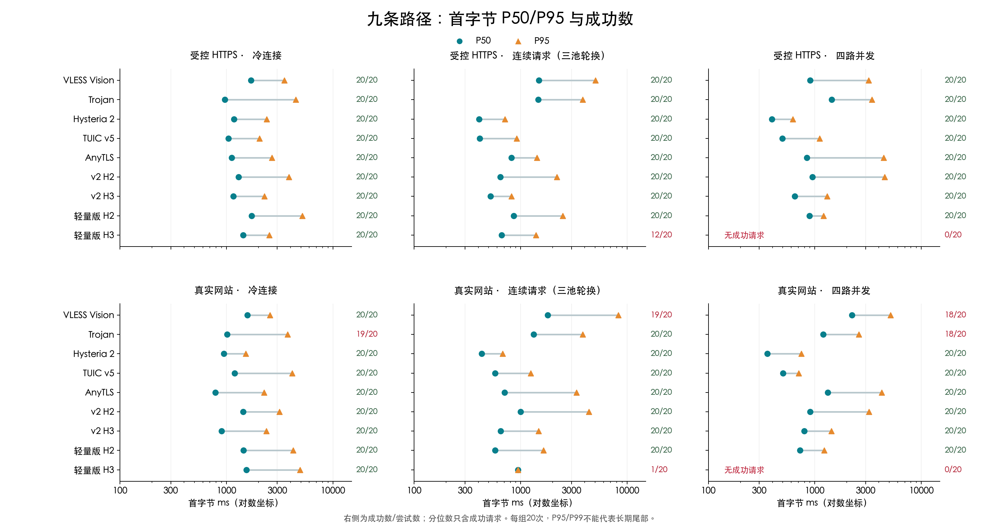
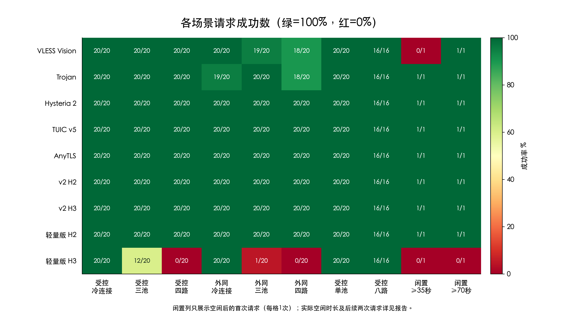
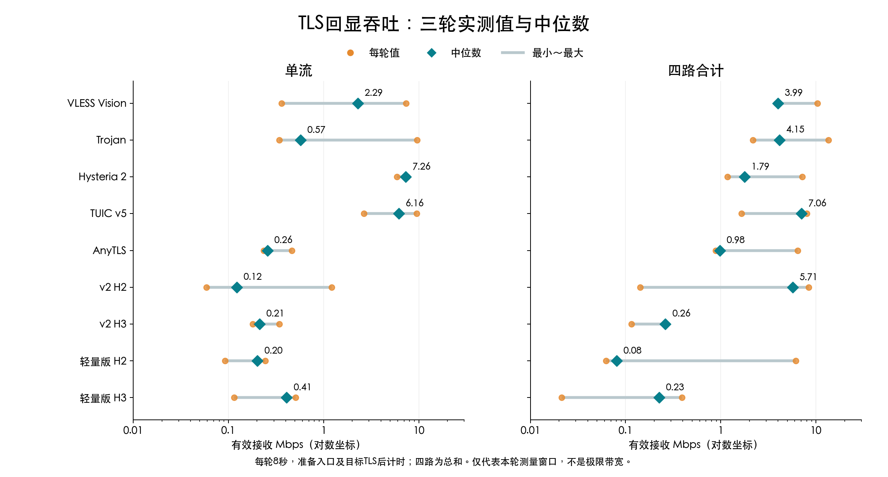

# 七类协议、九条路径：安卓同网详细对照与分析

日期：2026-11-21。

## 主要结论

本轮不能继续用“v2所有性能都最好”概括结果。Hysteria 2与TUIC在持续请求、部分并发和下载方面更有竞争力；v2的短请求可靠性良好，但大文件尤其H3仍明显不足。轻量版H3在忙时单池请求可以很快，空闲后的新业务恢复存在明确缺口。

- **短请求**：真实网站三池轮换，Hysteria 2为431.6/676.5ms（P50/P95），TUIC为573.6/1241.4ms，v2 H3为651.1/1470.2ms。
- **单池连续**：TUIC中位308.8ms，Hysteria 2为428.8ms；后者P95为595.3ms，低于TUIC的754.3ms。二者侧重点不同。
- **可靠性**：v2两条路径、轻量版H2、Hysteria 2、TUIC、AnyTLS各162/162个正式短请求成功；VLESS Vision为157/162，Trojan为159/162，轻量版H3为89/162。该统计是多场景的描述性合计，不是长期独立成功率证明。
- **传输**：三轮单流有效吞吐中位Hysteria 2为7.26Mbps、TUIC为6.16Mbps；四路合计中位TUIC为7.06Mbps，v2 H2为5.71Mbps，但后者三轮从0.14到8.36Mbps，不能只看中位数。
- **完整下载**：1MiB两轮中，v2 H3为0/2，v2 H2与轻量版H3各1/2；其余路径为2/2。
- **实现差异**：本项目锁定QUIC库的默认拥塞控制是Reno；Hysteria 2/TUIC使用BBR。接收窗口、保活和会话调度也不同。此轮是实际组合对照，不能把全部差距归为协议帧格式或某个加密算法。

[可搜索、排序的完整数据页](DATA.html) · [逐请求CSV](requests.csv) · [全部分布CSV](latency-summary.csv) · [吞吐CSV](throughput-summary.csv) · [下载CSV](download-summary.csv) · [空闲恢复CSV](idle-summary.csv)

## 环境与实际配置

设备TFY-AN00，Android 12/API31，MT6833V/PNZA，arm64；客户端Go1.26.2。服务器Linux6.12.117+deb13-amd64，1个在线CPU，内核TCP拥塞控制BBR；服务端Go1.27.3。服务器为共享运行环境，没有做CPU或网络隔离；测试前负载快照约0.26，不能代表整个测量期间。

五种通用协议均调用CatNode实际V2Core.Start/AddNode/AddUsers及其自定义dispatcher、计数与limiter，Xray运行版本26.10.31。测试用户不设速度、设备/IP限制，不连接生产面板，不消耗现有账号套餐。Hysteria 2、TUIC的服务端是CatNode所用Xray分支实现，不能自动外推到其他官方/第三方服务端。

| 路径 | 实际组合与关键参数 |
|---|---|
| VLESS Vision | TCP + TLS + xtls-rprx-vision；额外VLESS加密关闭；没有REALITY/WS/gRPC/Xray mux |
| Trojan | 原生Trojan + TCP + TLS；没有额外Shadowsocks层或WS/gRPC |
| Hysteria 2 | QUIC + TLS1.3；客户端带宽不指定、BBR；服务端不强制Brutal；不启用混淆、端口跳跃 |
| TUIC v5 | QUIC + TLS1.3 + BBR；0-RTT/ReduceRtt/FastOpen关闭；默认10秒心跳 |
| AnyTLS | 原生TLS承载；默认填充方案；会话复用开启，空闲检查/超时默认30秒，最少空闲会话0 |
| v2 H2 | HTTP/2 + TCP + TLS1.3 + 令牌；保留上一轮目标错峰拨号及客户端连接池优化 |
| v2 H3 | HTTP/3 + QUIC + TLS1.3 + 令牌；当前固定H3，不经过自动选路 |
| 轻量版H2/H3 | v3-light-fast / IndependentPipelined；原型Noise认证与轻量独立流；协议实现未临时优化 |

统一入口IP191.223.214.8，域名zlhk.fastcat.ink及同一有效证书，证书验证开启。入口地址固定IP，本轮没有入口DoH/ECH、REALITY或前置。VLESS与Trojan运行时观察为TLS1.3及TLS_CHACHA20_POLY1305_SHA256；AnyTLS适配器内部握手字段未被本工具提取，不声称已测到其具体套件。QUIC路径及v2/轻量H2的TLS1.3由代码配置约束。未跨所有栈强制相同TLS指纹或密码套件。Trojan宣告的ALPN h2不代表Trojan在用HTTP/2承载。

临时入口：v2 19442，轻量版19444，VLESS19446，Trojan19448，Hysteria 2/UDP19450，TUIC/UDP19451，AnyTLS19452；控制回显19445、控制HTTPS19454。

### 默认连接策略不能混为一谈

VLESS/Trojan在本配置中每个业务新建TCP/TLS连接。v2和轻量版的多条业务可共享H2/H3入口。Hysteria 2/TUIC复用QUIC连接。当前AnyTLS客户端取出空闲session，业务结束后才归还；并发扩容可新建多条TLS连接，不等同同一条TCP上的HTTP/2多流并发。没有统一底层连接数量或对所有实现强行开mux，因为这些就是本轮配置的实际行为。

Hysteria 2客户端默认10秒保活，TUIC默认10秒心跳；v2与轻量版未增加周期保活。空闲场景比较包含这项取舍，不能把恢复速度直接换算为耗电优势。

## 方法与计数

采用同一台安卓、同一Wi-Fi、同一服务器，按轮交换协议与载体顺序。各测试组序贯运行，组内按指定并发数执行，测量没有相互重叠。所有阶段及插入组前后的物理默认网络均为171。手机原VPN在测量期间断开，运行独立原生核心；不是正式快猫App经过TUN的端到端验收。

| 测试组 | 每条路径的正式样本 | 合计 |
|---|---:|---:|
| 受控HTTPS：冷连接/三池连续/四路并发 | 20 + 20 + 20 | 540 |
| 真实网站：冷连接/三池连续/四路并发 | 20 + 20 + 20 | 540 |
| 受控目标单池串行 | 20 | 180 |
| 受控目标八路并发 | 2批×8 | 144 |
| 业务空闲至少35秒后首次及两次独立跟进 | 3 | 27 |
| 业务空闲至少70秒后首次及两次独立跟进 | 3 | 27 |
| **正式短请求合计** | **162** | **1458** |
| 连接池预热（不计正式成功率） | 10 | 90 |
| 公网预检（不计正式成功率） | 4 | 36 |
| 1MiB校验下载 | 2 | 18 |
| 8秒TLS回显：单流/四路各3轮 | 6组 | 54组、135条流 |

受控目标在同服务器19454端口固定返回HTTPS 200，强制目标TLS1.3；减少第三方CDN、目标地址与内容变化。CatNode默认SNI嗅探仍可能将固定IP目标重写为固定域名并解析，因此不称为完全零DNS开销。真实网站为example.com:443，HEAD 200才算成功。两类目标在不同时段测量，不能直接将两表差值当成纯CDN/DNS开销。

冷连接指新建协议客户端及入口后的首次请求；连续请求保留客户端，三池组按轮轮换3个独立池；单池组始终使用一个客户端，原始程序以单worker batch执行20个串行轮次，汇总逻辑名continuous_pool1。四路/八路均在同一个客户端池内并发，实际是否新增物理连接依各栈策略。

首字节TTFB从业务开始计时至目标HTTP响应首字节，包含相应入口建立、目标连接、目标TLS与响应等待。不是面板ICMP延迟或App启动时间。所有普通请求预算12秒；文件下载预算30秒。失败单独保留，不用重试结果替代；空闲后的三次是三次独立HEAD请求，不自动重放已有业务。

### 统计口径

P50为样本中位数，P90/P95/P99使用最近秩；均值、标准差、最大值与全部原值见CSV/数据页。延迟分位数只含成功请求，失败不记为0ms。每组通常20次，P99大多就是最大值，不能视为精确长期P99。并发组按轮分块重采样2000次，输出中位数95%参考区间；小轮次数、时段变化和池内相关性均限制解释。成功率Wilson区间仅作为独立尝试假设下的参考，未用来宣称长期可用率。

原始entry/target_tls/response阶段仅表示该实现中观测位置。v2常在CONNECT响应前建立目标，VLESS/Trojan等可将目标建立延后至内层TLS，所以阶段分位数不能横向当成完全相同的工作，也不能把各阶段P50简单相加等同总P50。

## 首字节结果

单位ms，每格P50 / P95；成功数覆盖该目标三种场景，共60次。

### 受控HTTPS

| 路径 | 成功/60 | 冷连接 | 三池连续 | 四路并发 |
|---|---:|---:|---:|---:|
| VLESS Vision | 60/60 | 1,703.6 / 3,496.5 | 1,481.9 / 5,054.5 | 903.1 / 3,209.5 |
| Trojan | 60/60 | 963.2 / 4,480.5 | 1,464.4 / 3,834.7 | 1,444.3 / 3,428.4 |
| Hysteria 2 | 60/60 | 1,178.4 / 2,385.9 | 407.7 / 712.7 | 396.5 / 622.1 |
| TUIC v5 | 60/60 | 1,045.7 / 2,044.4 | 413.0 / 917.8 | 494.2 / 1,107.8 |
| AnyTLS | 60/60 | 1,118.3 / 2,665.0 | 820.1 / 1,424.3 | 839.2 / 4,439.6 |
| v2 H2 | 60/60 | 1,299.7 / 3,853.1 | 644.2 / 2,188.9 | 949.2 / 4,538.1 |
| v2 H3 | 60/60 | 1,159.8 / 2,278.2 | 520.7 / 820.9 | 646.1 / 1,306.5 |
| 轻量版 H2 | 60/60 | 1,719.0 / 5,147.8 | 861.3 / 2,481.6 | 889.1 / 1,205.4 |
| 轻量版 H3 | 32/60 | 1,433.8 / 2,524.3 | 664.5 / 1,390.6 | — / — |

### 真实网站

| 路径 | 成功/60 | 冷连接 | 三池连续 | 四路并发 |
|---|---:|---:|---:|---:|
| VLESS Vision | 57/60 | 1,567.6 / 2,556.6 | 1,797.7 / 8,245.1 | 2,239.9 / 5,154.5 |
| Trojan | 57/60 | 1,011.3 / 3,759.0 | 1,328.1 / 3,838.1 | 1,199.0 / 2,583.3 |
| Hysteria 2 | 60/60 | 945.6 / 1,522.8 | 431.6 / 676.5 | 358.9 / 746.0 |
| TUIC v5 | 60/60 | 1,191.3 / 4,150.7 | 573.6 / 1,241.4 | 503.1 / 703.7 |
| AnyTLS | 60/60 | 785.9 / 2,262.2 | 709.0 / 3,351.9 | 1,324.7 / 4,256.7 |
| v2 H2 | 60/60 | 1,431.8 / 3,149.0 | 999.8 / 4,373.8 | 903.9 / 3,228.3 |
| v2 H3 | 60/60 | 897.9 / 2,368.2 | 651.1 / 1,470.2 | 794.9 / 1,428.0 |
| 轻量版 H2 | 60/60 | 1,443.6 / 4,233.6 | 576.4 / 1,640.1 | 725.0 / 1,229.0 |
| 轻量版 H3 | 21/60 | 1,535.8 / 4,925.9 | 947.4 / 947.4 | — / — |

轻量版H3真实网站三池组只有1/20成功，该格947.4/947.4ms只代表一个成功样本；两类目标的四路组都是0/20，没有可用分位数。不能将快速失败或少量成功解释为低延迟优势。

### 单池与八路补充

单池组及八路组均使用受控目标，但测量时段不同。单位ms，格内P50 / P95。

| 路径 | 单池成功/20 | 单池连续 | 八路成功/16 | 八路并发 |
|---|---:|---:|---:|---:|
| VLESS Vision | 20/20 | 1,828.2 / 3,031.7 | 16/16 | 1,193.5 / 4,189.3 |
| Trojan | 20/20 | 1,055.0 / 2,457.7 | 16/16 | 950.8 / 2,274.9 |
| Hysteria 2 | 20/20 | 428.8 / 595.3 | 16/16 | 529.5 / 1,453.1 |
| TUIC v5 | 20/20 | 308.8 / 754.3 | 16/16 | 727.9 / 866.1 |
| AnyTLS | 20/20 | 527.8 / 984.9 | 16/16 | 936.1 / 10,885.6 |
| v2 H2 | 20/20 | 757.7 / 2,099.3 | 16/16 | 1,632.3 / 2,921.1 |
| v2 H3 | 20/20 | 816.4 / 1,879.3 | 16/16 | 1,022.7 / 1,699.7 |
| 轻量版 H2 | 20/20 | 1,141.8 / 2,142.5 | 16/16 | 773.7 / 877.6 |
| 轻量版 H3 | 20/20 | 493.1 / 709.6 | 16/16 | 863.3 / 2,059.3 |

轻量版H3单池20/20、八路16/16；同时三池组大量关闭错误，表明其忙时传输与空闲会话管理必须分开评价。不能将不同时段的中位数差值全部归因于池数。AnyTLS八路P50约936ms但P95约10886ms，第一批最大约10.9秒，第二批最大约1.69秒；与默认会话扩容/新建连接及网络变化都可能有关，尚未以服务端trace确定原因。

### 1秒内成功比例

以全部尝试为分母，失败不被剔除。该指标比只看成功请求中位数更能反映这一轮的及时可用性。

| 路径 | 外网冷连接 | 外网三池连续 | 外网四路 | 受控单池 | 受控八路 |
|---|---:|---:|---:|---:|---:|
| VLESS Vision | 30.0% | 25.0% | 20.0% | 30.0% | 43.8% |
| Trojan | 40.0% | 30.0% | 35.0% | 45.0% | 50.0% |
| Hysteria 2 | 55.0% | 100.0% | 100.0% | 100.0% | 81.2% |
| TUIC v5 | 40.0% | 90.0% | 100.0% | 95.0% | 100.0% |
| AnyTLS | 55.0% | 85.0% | 35.0% | 95.0% | 56.2% |
| v2 H2 | 15.0% | 50.0% | 60.0% | 75.0% | 50.0% |
| v2 H3 | 70.0% | 85.0% | 75.0% | 75.0% | 43.8% |
| 轻量版 H2 | 25.0% | 75.0% | 85.0% | 40.0% | 100.0% |
| 轻量版 H3 | 15.0% | 5.0% | 0.0% | 100.0% | 56.2% |

## 可靠性与空闲恢复

| 路径 | 全场景短请求成功/162 | 主要失败 |
|---|---:|---|
| VLESS Vision | 157/162 | entry: 191.223.214.8:19446 connect error: context deadline exceeded ×2；target TLS: EOF ×2；target TLS: read tcp 192.168.31.15:49066->191.223.214.8:19446: read: connection reset by peer ×1 |
| Trojan | 159/162 | target TLS: EOF ×2；entry: 191.223.214.8:19448 connect error: context deadline exceeded ×1 |
| Hysteria 2 | 162/162 | 无 |
| TUIC v5 | 162/162 | 无 |
| AnyTLS | 162/162 | 无 |
| v2 H2 | 162/162 | 无 |
| v2 H3 | 162/162 | 无 |
| 轻量版 H2 | 162/162 | 无 |
| 轻量版 H3 | 89/162 | entry: use of closed network connection ×73 |

轻量版H3共73次关闭错误，主要集中于三池轮换、随后并发和两轮空闲实验；这些具有明显相关性，不能当成73个独立随机网络失败。VLESS/Trojan的TCP连接超时、EOF和reset仅能确定观察阶段，没有服务端逐连接关闭原因，不能直接归因于目标网站或协议本身。

空闲实验先为所有路径做一次请求，再等待名义35/70秒并按序恢复。由于预热及恢复串行，实际业务空闲分别约48.5～79.7秒与87.7～95.0秒。每窗每路径只有一次首次恢复，后续两次独立请求用于查看是否持续失效；不按这一两次样本做恢复速度长期排名。

| 路径 | ≥35秒：实际闲置/首次结果/后两次 | ≥70秒：实际闲置/首次结果/后两次 |
|---|---|---|
| VLESS Vision | 51.5s / 失败 / 1/2 | 93.1s / 成功 740.5ms / 2/2 |
| Trojan | 69.0s / 成功 716.8ms / 2/2 | 90.0s / 成功 546.4ms / 2/2 |
| Hysteria 2 | 79.7s / 成功 399.9ms / 2/2 | 92.6s / 成功 280.6ms / 2/2 |
| TUIC v5 | 79.6s / 成功 1186.8ms / 2/2 | 92.9s / 成功 270.8ms / 2/2 |
| AnyTLS | 78.1s / 成功 2028.5ms / 2/2 | 90.9s / 成功 2604.1ms / 2/2 |
| v2 H2 | 48.5s / 成功 1316.1ms / 2/2 | 87.7s / 成功 4475.1ms / 2/2 |
| v2 H3 | 50.0s / 成功 905.7ms / 2/2 | 93.9s / 成功 1532.4ms / 2/2 |
| 轻量版 H2 | 51.8s / 成功 1021.0ms / 2/2 | 91.8s / 成功 2023.0ms / 2/2 |
| 轻量版 H3 | 52.6s / 失败 / 0/2 | 95.0s / 失败 / 0/2 |

越过v2 H3的60秒空闲阈值后，新业务仍能完成；轻量版H3两个窗口均连续三次失败。其源码MaxIdleTimeout=30秒，认证流关闭后客户端整体关闭，后续Dial没有按需重建；行为与源代码一致。未记录QUIC内部关闭cause，因此“具体关闭由idle timer触发”仍是推断，“过期/关闭后新业务无法恢复”则已复现。Hysteria 2/TUIC有10秒保活，实际业务空闲不等同QUIC连接完全无包。VLESS/Trojan本来每次新建连接，不应将VLESS一次失败直接叫作复用池恢复故障。

## 三轮吞吐

所有路径在隧道内再建立同样、验证通过的目标TLS1.3，然后运行全双工回显。使Vision能观察真实内层TLS握手。每轮准备完成后传输8秒，按实际收到并通过模式校验的解密数据计有效下载Mbps；四路是合计。发送accepted字节不当作对端实际收到，不含IP/UDP头，不能与运营商线速或单向下载直接等同。135条流均得到有效数据且未提前报错，不代表固定文件都传完。

| 路径 | 单流三轮 Mbps | 单流均值/中位 | 四路三轮 Mbps | 四路均值/中位 |
|---|---|---:|---|---:|
| VLESS Vision | 7.339 / 2.293 / 0.360 | 3.331 / 2.293 | 10.379 / 3.849 / 3.991 | 6.073 / 3.991 |
| Trojan | 9.578 / 0.344 / 0.573 | 3.499 / 0.573 | 4.155 / 2.179 / 13.493 | 6.609 / 4.155 |
| Hysteria 2 | 5.898 / 7.569 / 7.257 | 6.908 / 7.257 | 7.192 / 1.786 / 1.179 | 3.386 / 1.786 |
| TUIC v5 | 6.160 / 9.486 / 2.654 | 6.100 / 6.160 | 7.061 / 1.655 / 8.044 | 5.586 / 7.061 |
| AnyTLS | 0.465 / 0.235 / 0.258 | 0.319 / 0.258 | 0.883 / 0.976 / 6.409 | 2.756 / 0.976 |
| v2 H2 | 1.212 / 0.122 / 0.059 | 0.464 / 0.122 | 5.714 / 0.143 / 8.360 | 4.739 / 5.714 |
| v2 H3 | 0.180 / 0.213 / 0.344 | 0.246 / 0.213 | 0.262 / 0.115 / 0.262 | 0.213 / 0.262 |
| 轻量版 H2 | 0.202 / 0.243 / 0.092 | 0.179 / 0.202 | 0.081 / 0.063 / 6.152 | 2.098 / 0.081 |
| 轻量版 H3 | 0.410 / 0.508 / 0.115 | 0.344 / 0.410 | 0.021 / 0.226 / 0.390 | 0.213 / 0.226 |

单流Hysteria 2三轮范围5.90～7.57Mbps，相对集中；TUIC四路中位较高，但其最低一轮只有1.66Mbps，仍存在明显波动。v2 H2四路中位5.71Mbps伴随0.14～8.36Mbps范围，Trojan四路峰值13.49Mbps而中位4.15Mbps，均说明不能只报峰值或用一轮判定长期优劣。不同协议并发时的物理连接数量不同，也可能影响拥塞窗口和路径分配。

## 完整1MiB下载

每路径2次独立新客户端，30秒预算。GET固定1MiB、Content-Length验证及SHA-256校验全部通过才算完成。端到端速率含入口、目标TLS与接收；另有body阶段速率保留在原始数据，后者可能受缓冲影响，不作为主排名。

| 路径 | 完整/2 | 第1轮 | 第2轮 | 完整样本端到端速率中位 Mbps |
|---|---:|---|---|---:|
| VLESS Vision | 2/2 | 2.231s | 2.752s | 3.4 |
| Trojan | 2/2 | 21.513s | 6.234s | 0.9 |
| Hysteria 2 | 2/2 | 2.121s | 1.667s | 4.5 |
| TUIC v5 | 2/2 | 3.835s | 1.593s | 3.7 |
| AnyTLS | 2/2 | 17.611s | 2.499s | 1.9 |
| v2 H2 | 1/2 | 2.861s | 超时 30.0s（收到0.953MiB） | 2.9 |
| v2 H3 | 0/2 | 超时 30.0s（收到0.359MiB） | 超时 30.0s（收到0.453MiB） | — |
| 轻量版 H2 | 2/2 | 5.799s | 3.669s | 1.9 |
| 轻量版 H3 | 1/2 | 18.387s | 超时 30.0s（收到0.469MiB） | 0.5 |

v2 H3两次都在约2秒收到首字节之后继续接收了0.359/0.453MiB，最终在传输阶段超时；v2 H2第二轮已收到约0.953MiB后超时，轻量版H3第二轮收到0.469MiB后超时。它们已通过入口与目标TLS，并得到HTTP响应，不应再把这些失败统称为入口DNS或认证失败。短HEAD成功不能替代大文件完整性验收。

## 数据说明了哪些原因，哪些还不能确定

### 已有直接证据的结论

1. **没有全场景冠军。** Hysteria 2在本轮外网复用/四路及单流吞吐较好；TUIC在单池中位和四路吞吐中位较好，八路尾部也较低；AnyTLS外网冷连接中位较低，但八路有明显慢尾；v2短请求完整性好，但文件稳定性不足。
2. **轻量版H3优先补生命周期。** 单池20/20且中位493ms，三池和空闲后大量关闭，表明“闭合会话后无法为新业务重建”比继续压缩认证字节更紧迫。忙时快与闲置后不可用同时成立。
3. **v2的优化方向要扩展到数据面。** v2 H3小请求全成功与1MiB下载0/2同时成立。通过了DNS/握手不意味着后续持续传输已优化完成。
4. **默认拥塞控制和窗口不是一致条件。** 下表为本项目锁定代码的客户端接收窗口，不是所有实现的行业默认，也不是服务端全部参数。

| 路径 | 当前拥塞控制 | 客户端初始/最大单流接收窗 | 初始/最大连接接收窗 |
|---|---|---|---|
| v2/轻量版H3 | 本项目quic-go默认Reno | 2 / 6 MiB | 3 / 15 MiB |
| Hysteria 2 | BBR（未指定带宽时本组合） | 8 / 8 MiB | 20 / 20 MiB |
| TUIC | BBR | 约1.5 / 15 MiB | 约6.4 / 64 MiB |

证据来自锁定版本sent_packet_handler.go中NewCubicSender(..., true /* use Reno */)，以及Hysteria 2/TUIC的BBR设置。函数名带Cubic并不代表此处启用了Cubic。服务器TCP内核BBR也不等同于QUIC用户态Reno/BBR；XTLS Vision的流处理策略与这些拥塞控制也属于不同层。

### 有依据的待验证方向

- 先在v2 H3同一入口、同一窗口做Reno/BBR的隔离A/B，再决定默认策略。当前差距使它成为优先候选，但本轮没有只切换算法，不能把全部收益归于BBR。
- 1MiB小于当前v2客户端2MiB初始单流接收窗，此场景也很慢，不能仅凭吞吐低就判断窗口不足；应采集重传、拥塞窗口、flow-control blocked与包时序后调整。
- VLESS/Trojan的EOF、reset与连接超时需服务端握手/关闭原因对齐。CatNode默认策略握手4秒、空闲120秒、缓冲128KiB，未与v2 HTTP服务策略统一；不能把失败都算作协议格式问题。
- AnyTLS并发尾部应区分首次会话扩容与复用、并记录物理连接数；本轮未做填充消融，不将慢尾直接归因于填充。
- TCP/QUIC吞吐波动还可能受端口/五元组路径、重传、时间段与共享负载影响；未交换端口或做受控丢包实验。

### 对当前开发优先级的建议

第一，轻量版为新业务增加会话失效后的按需重建、频率限制及失败分层，继续保持已有业务不重放。第二，v2 H3优先做拥塞控制的单变量试验，并用1MiB/更大文件校验复测数据面。第三，以Hysteria 2与TUIC保留性能基线，以成熟TCP路径保留UDP不可用时的候选；选路同时考虑成功率、1秒/2秒内成功比例和P95，不用单轮最小延迟决定。第四，再以App真实进程做耗电、切网、锁屏与长时间多用户验收。此轮未据此更改生产默认协议。

## 资源数据与证据限制

吞吐原始数据含传输期Go分配量、堆快照及关闭后的goroutine数，汇总见CSV/数据页。这些来自同一测试进程、不同流量规模和GC时点；握手准备部分未纳入传输期分配，未采集协议级CPU或能耗，不能用堆快照给正式App做内存或耗电排名。另保留了测试端口TCP连接数的5秒采样；采样峰值只是下界，可能错过短连接，不当作每组精确连接数。

这一轮只有一台安卓、一个Wi-Fi、一个服务器；受控与外网分时进行，未固定外网CDN地址，默认SNI嗅探/后端DNS仍有实现差别。不是蜂窝、跨网或前置测试，不覆盖UDP业务、真实浏览器全页面、长期可用性、抗识别率或GFW阻断概率。协议外层TLS、默认填充、连接数量与拥塞控制未统一，所以结果对应当前完整组合，不是对协议本身的绝对排名。20次/组与3次吞吐仅够发现明显问题和生成下一步假设。

## 交付、自检和复现

- 公网正式测量前，CatNode五协议本地启动和9路径36条公网预检通过。
- 测试工具的路径矩阵、显式套接字回收、跨读取边界校验、有效/损坏下载校验以及竞态检查通过；Go vet通过。TUIC适配器默认没有显式池Close，本工具使用按测试实例回收的标准TCP/UDP拨号器，避免冷样本后台保活残留。
- 二进制、模块、证书和源文件哈希见metadata及清单；原始记录、字段汇总与阶段观察位置均保留。图表经渲染检查。
- 协议实现未在本轮临时调整；额外单池和70秒组在既有测量完成后插入，没有与其他测量重叠，插入时间记录在orchestration文件。

原始JSONL保留微秒值，CSV转换为毫秒，并同时保留原始/逻辑场景名。HTML支持搜索和按列排序；REPORT为分析，DATA为完整数据。图表提供PNG和SVG。

临时19442/19444/19445/19446/19448/19450/19451/19452/19454入口已停止，临时凭证及远端文件已清理；手机原VPN和stay-on设置0已恢复。生产443/18447和正式App没有替换。
