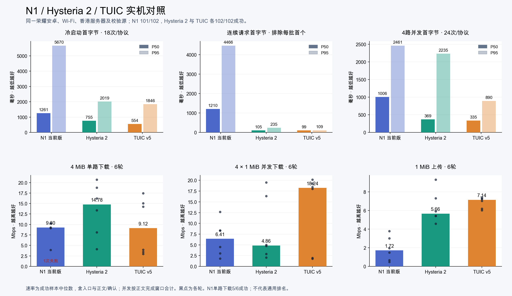

# N1 当前版、Hysteria 2、TUIC v5 安卓实机对照

**本轮 TUIC 的交互延迟和上传表现最好，Hysteria 2 的单路下载中位数最高。当前 N1 没有综合性能优势。** N1 单路下载与 TUIC 的中位数接近，四路下载中位数高于 Hysteria 2，但轮次波动较大，且 N1 有一次失败，不能据此认定稳定领先。

测试日期：2026-11-25，正式样本时间 **00:46:13–00:55:57（北京时间）**。设备为当前 USB 连接的荣耀 TFY-AN00 / Android12，实际已验证的 Wi-Fi；服务器 zlhk.fastcat.ink / 191.223.214.8。没有安装或升级正式快猫 App。

## 主要结果

首字节单位为 ms，表内为 P50 / P95；速率为 Mbps。延迟/单路速率只统计成功请求，同时单列失败。四路吞吐使用各轮成功校验字节数除以实际正文完成窗口，包含新入口建立，排除最后一条业务完成后的关闭等待。

|指标|N1 当前版|Hysteria 2|TUIC v5|
|---|---:|---:|---:|
|全部请求成功|101/102|102/102|102/102|
|冷启动首字节（各18次）|1261 / 5670|755 / 2019|554 / 1846|
|连续请求首字节（各21次，排除各批首个）|1210 / 4466|105 / 235|99 / 109|
|4路并发首字节（各24次，每条128KiB）|1006 / 2461|369 / 2235|335 / 890|
|4MiB单路下载速率中位数|9.30（5/6成功）|14.78（6/6）|9.12（6/6）|
|4×1MiB并发下载合计速率中位数（各6轮）|6.41|4.86|18.24|
|1MiB上传速率中位数（各6轮）|1.72|5.66|7.14|

这里“冷启动”指每次新建协议客户端适配器和入口，同批仍共享测量程序进程；不是App、VPN或手机开机冷启动。

P95用线性插值计算，只代表此次有限样本，不是长期承诺值。连续请求每批8次、三批：第一个仍保留在总成功率和原始记录，只从复用阶段延迟统计中排除，剩余21次。N1本身不复用外层连接，因此其“连续请求”仍逐次新建入口，没有偷偷打开缓存或预热。

N1 的冷启动首字节中位数约为 TUIC 的2.28倍；连续请求约12.18倍；并发首字节P95约2.77倍。TUIC 本轮四路吞吐中位数约为 N1 的2.84倍、上传约4.15倍。它没有在所有负载中领先：单路下载由 Hysteria 2 的中位数领先，TUIC自身也有慢轮次。

## 六轮吞吐原始值

按时间顺序列出。单路/上传含入口建立及正文/确认；四路值是合计速率，不是四条流各自的平均速率。

|项目|N1|Hysteria 2|TUIC|
|---|---|---|---|
|4MiB单路下载|3.93、9.30、失败、10.29、9.13、10.26|13.38、4.09、16.19、18.78、20.71、8.12|14.25、2.96、3.99、3.43、17.44、15.05|
|4×1MiB并发下载|4.50、1.80、3.04、8.33、12.67、8.33|16.33、2.89、19.53、4.74、4.98、2.04|1.79、18.02、18.45、20.17、19.27、1.97|
|1MiB上传|1.95、0.68、3.02、3.78、0.47、1.49|5.42、9.31、7.30、5.91、5.41、4.58|7.42、6.01、7.04、7.24、6.18、7.26|

前三轮属于主矩阵；后三轮为预先固定数量的补测。由于首两轮单路结果各自已经出现大于2倍波动，补测方案在主测尚未结束时固定为三轮下载/上传，没有根据好坏挑选或不断重测。主测252请求，补测54请求，共306。补测和主测均保留完整原始文件。

**下载结论要谨慎。** N1与TUIC单路中位数只差约2%，TUIC单路却在约3–17Mbps间变化，不能称N1在单路上更快。四路的N1与Hysteria 2范围也高度重叠；本轮TUIC的四路中位数更好，但它仍有约1.8–2Mbps的慢轮次。没有把峰值当作持续速度。

## 统一了什么，保留了哪些实现差别

- 同一物理手机、Wi-Fi、服务器、证书/域名与测试目标；每个类别每三轮轮换协议位置，每种协议各处于第一/第二/第三位一次。
- 入口统一用字面IPv4，仍校验zlhk.fastcat.ink证书链和名称，均不跳过验证。这轮有意排除入口DNS差异。
- 目标为服务器127.0.0.1:18476，提供同一确定性字节流。下载逐字节校验；上传服务端逐字节校验后返回已接收字节数。目标是隧道内普通HTTP，**没有目标HTTPS握手和外部网站/CDN/出口带宽差异**。因此结果不能直接当成访问Google等网站的完整耗时。
- 每次目标请求使用新TCP业务，Connection: close。冷启动每次销毁整个客户端适配器及其底层socket；连续/并发在同批保留适配器，让协议使用自己支持的复用。
- N1：最终阶段TCP/TLS1.3 + HTTP/1.1全双工POST + 自定义授权/记录层，双端coalesced，下行封装Write限额16384B；认证前最多2次建连尝试，内存TLS缓存关闭，默认密钥协商，不使用ECH。
- TUIC v5：现有快猫Mihomo适配器，BBR，ReduceRtt=false、FastOpen=false，没有打开0-RTT。
- Hysteria 2：现有快猫Mihomo适配器，自动带宽，双端代码确认走BBR；不配置固定Brutal带宽，不加混淆。客户端本轮未开启业务0-RTT重放。
- 两种QUIC服务端使用当前CatNode/Xray封装（Xray26.10.31及仓库固定fork）；N1为独立原型。两端BBR不是同一份实现，QUIC默认窗口/ACK策略也不同，因此这是**当前实现与配置的对比**，不是排除一切实现差异的抽象协议算法排名。
- 测试服务仅明确允许该回环目标，未更改正式节点策略。Native服务保留CatNode默认协议嗅探，因此测试HTTP Host明确填实际回环地址，防止目标被重写。
- Android统一测量程序以Go1.26.11构建；N1服务同为Go1.26.11，CatNode测试服务按其go.mod使用独立Go1.27.4构建。构建版本、依赖和SHA256均随报告保存。

## N1为什么慢

最明确的结构差异是**入口复用**。N1的连续访问仍为每个目标建立TCP/TLS并等待应用授权；本轮关闭TLS缓存。TUIC/Hysteria 2可在已认证QUIC连接上新建业务流，后续请求省去重复入口握手。抓包观察N1有103条对端TCP流，两种QUIC各42条对端UDP流，与这一差异相符；流统计可能包含重试，不等同于有效业务数。

N1的写入限额改善的是某类TLS拆分短尾，并没有减少这些握手往返，也没有建立共享入口；因此此前分段优化不应被解释为已经具备成熟QUIC协议的连续请求性能。本轮上传也存在明显慢尾，入口建立不能解释全部延迟：一次上传入口约1083ms，而收到校验确认约17715ms，后续传输/排队同样需要定位。

这些观察不能把所有慢请求都归因于协议设计。网络/实现因素仍混在一起，且N1四路是多个独立TCP连接，两种QUIC可复用连接，并不是等数量物理连接的拥塞算法实验。

## 失败及异常记录

N1主测第三轮4MiB单路下载在**目标响应头阶段截断**：入口返回约11124ms，总时间约13479ms；没有完整校验，未输出成功速率。仅可定位到入口之后的目标响应头阶段，当前证据不足以确定最初断开来自何处。失败记录在`raw/34-n1-download-w1-b3.jsonl`，未被后续成功结果替换。N1补测18/18通过；累计101/102。

正式测试前的部署/预检另存：目标程序首次构建平台错误、占位Host触发目标重写，以及Hysteria默认拒绝回环目标并延迟关闭。查明后只为测试目标增加显式许可并重启独立服务；完成三协议下载/上传六项预检才开始最终完整矩阵。早期部分矩阵（TUIC6条完成、Hysteria批次中断而未收齐stdout）在`aborted-policy-preflight/`，不混入正式结果，也没有删除。

测试后ICMP参考为8次中6次响应，176.65–310.97ms，平均216.05ms。这可能含ICMP限速或时变因素，不能说业务真实丢包率就是25%，也没有用它减去首字节来虚构“纯协议开销”。

## 资源与流量参考

|项目|N1|Hysteria 2|TUIC|
|---|---:|---:|---:|
|客户端采样RSS峰值 MiB|22.52|23.54|21.99|
|客户端Go heap峰值 MiB|6.92|6.31|5.40|
|客户端FD采样峰值|11|8|8|
|客户端goroutine采样峰值|8|16|13|
|成功校验业务字节 MiB|54.31|58.31|58.31|
|入口上下行合计采样IPv4字节 MiB|70.60|80.93|78.29|

资源来自同一测量程序各批独立进程的约1秒采样，采样点不是连续峰值保证。该程序同时链接三种协议组件，数字不代表正式App整机内存、电量或单独N1二进制的资源需求。未据此声称省电或CPU优势。

流量仅抓独立实验18466/18468/18469，snaplen96，只汇总头部元数据，不解密。226558个抓包记录，内核丢弃0。采样IP字节包含握手、HTTP、ACK、重传、失败请求和可能的offload影响，**不是纯封装额外字节，也不是精确以太网计费量**。N1少了4MiB成功业务，因此不能仅凭合计更小认定协议更省流量。原始pcap仍在服务器私有目录，未写入仓库。

## 交付、恢复与局限

- `combined/summary.json`及`combined/samples.json`为合并统计与306条样本；原主测/补测文件保持独立。
- `plan.json`、`declaration.json`、`throughput-recheck/plan.json`记录原方案、顺序和固定补测；`build-sha256.json`、客户端/服务端build-info及源码快照支持复核。
- 所有实验18466/TCP、18468/18469/UDP和18476源已停止，手机临时程序/凭证/指标文件已清理；没有改手机全局代理、VPN配置或安装App。原18461基线二进制校验值不变，生产节点93/94仍运行。

本轮只测TCP业务经三种隧道的表现，没有测UDP游戏/语音、蜂窝、切网、锁屏耗电或长期生产可靠性，也不检验GFW识别率。当前结论是：**在这台手机与此次Wi-Fi上，TUIC的交互体验更好；Hysteria 2单路下载更有优势；N1还需要解决重复入口成本、上传慢尾和此次截断问题。**
